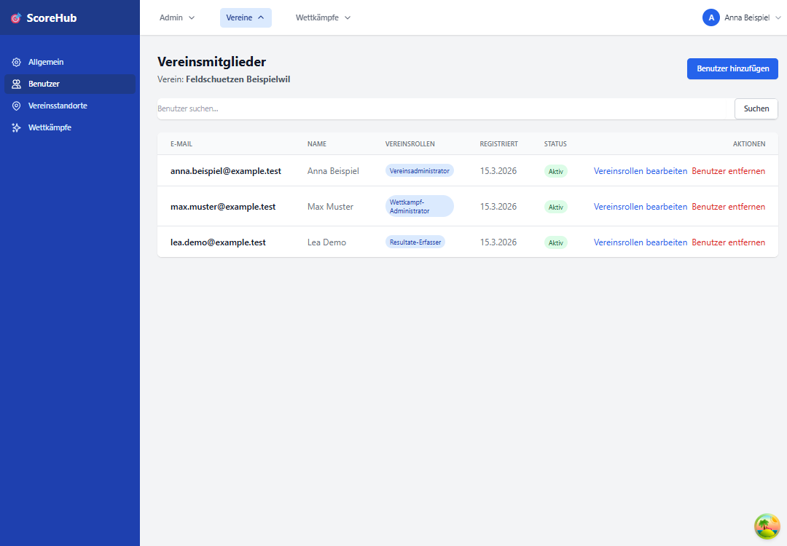

# Vereinsbenutzer verwalten

Die Seite **Benutzer** zeigt die Benutzerzuordnungen des aktuellen Vereins. Sie ist für Systemadministratoren und Vereinsadministratoren zur Bearbeitung vorgesehen.

## Einen vorhandenen Benutzer zuordnen

1. Öffnen Sie im Vereinsbereich **Benutzer**.
2. Wählen Sie die Aktion zum Hinzufügen eines Benutzers.
3. Suchen Sie nach einem bereits bestehenden Score_Hub-Konto.
4. Wählen Sie das passende Konto aus und fügen Sie es dem Verein hinzu.

Hierdurch wird ein bestehendes Benutzerkonto zugeordnet; die Oberfläche dient nicht zum Massenimport von Mitgliedern oder zum Versand von Einladungen per E-Mail.

## Vereinsrolle ändern

1. Suchen Sie die Person in der Vereinsbenutzerliste.
2. Öffnen Sie die Bearbeitung der Vereinsrolle.
3. Wählen Sie die zutreffende Rolle und speichern Sie die Änderung.

Die Oberfläche unterstützt Vereinsrollen wie Vereinsadministration, Wettkampfverwaltung und Resultaterfassung. Weisen Sie nur die Berechtigung zu, die für die Aufgabe erforderlich ist.

## Benutzer nicht gefunden?

Prüfen Sie die Schreibweise des Suchbegriffs. Die Zuordnung setzt voraus, dass bereits ein Score_Hub-Benutzerkonto existiert. Für neue Konten oder wenn Sie keine Bearbeitungsaktion sehen, kontaktieren Sie Ihre System- beziehungsweise Vereinsadministration.

Weiter: [Rollen und Berechtigungen](../getting-started/roles.md) · [Vereinsdaten](setup-club.md)
