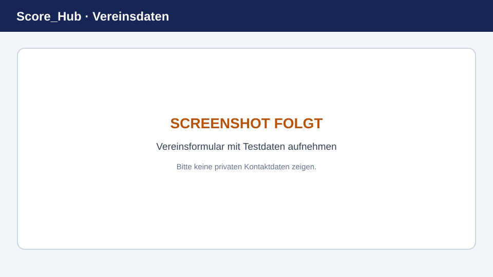

# Vereinsdaten verwalten

Im Vereinsbereich bearbeiten berechtigte Benutzer die Stammdaten des aktuell zugeordneten Vereins. Einen neuen Verein kann nicht jedes Benutzerkonto selbst anlegen. Wenn Ihr Verein fehlt oder Ihnen nicht zugeordnet ist, wenden Sie sich an die Systemadministration.

> **Platzhalterbild:** Ersetzen Sie diese Grafik durch einen aktuellen Screenshot. Details: [Screenshots ersetzen](../screenshots.md).

## Stammdaten öffnen und bearbeiten

1. Melden Sie sich an und öffnen Sie in der Navigation den Vereinsbereich.
2. Wählen Sie **Allgemein** beziehungsweise die Vereins-Stammdaten.
3. Prüfen Sie die vorhandenen Angaben. Je nach Datenmodell gehören dazu Vereinsname, Kurzname, Adresse, Postleitzahl, Ort, Kanton und Logo.
4. Wählen Sie **Informationen bearbeiten**, nehmen Sie die Änderungen vor und speichern Sie.
5. Prüfen Sie nach dem Speichern die angezeigten Daten.

Ob Sie bearbeiten können, hängt davon ab, ob Sie Systemadministrator oder Vereinsadministrator sind.

## Weitere Vereinsbereiche

- Unter **Benutzer** verwalten berechtigte Personen die Zuordnung und Vereinsrolle von Score_Hub-Benutzern.
- Unter **Standorte** pflegen Sie die dem Verein zugeordneten Standorte.
- Unter **Wettkämpfe** erstellen und verwalten Sie Vereinswettkämpfe.

Diese Bereiche erfassen nur die in der Anwendung vorhandenen Felder. Funktionen wie Mitgliedsbeiträge, Newsletter, Buchungen oder Datei-Massenimporte sind nicht Bestandteil dieser Anleitung.

Weiter: [Vereinsbenutzer](manage-members.md) · [Standorte](manage-locations.md) · [Wettkämpfe](../competitions/create-competition.md)
