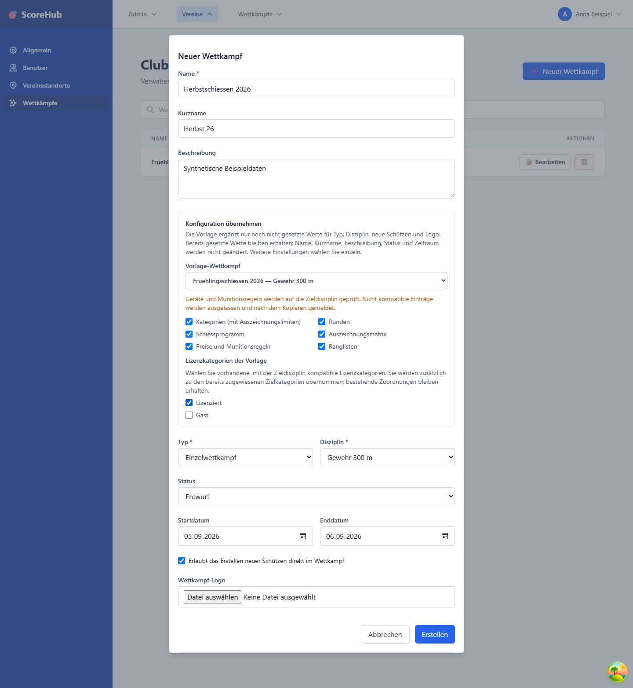

# Wettkampf erstellen

Wettkämpfe werden im Vereinsbereich verwaltet. Zum Anlegen oder Ändern benötigen Sie die entsprechende Vereins- oder Systemberechtigung.

## Neuen Wettkampf anlegen

1. Öffnen Sie **Verein → Wettkämpfe**.
2. Wählen Sie die Aktion zum Erstellen eines Wettkampfs.
3. Tragen Sie die angezeigten Grunddaten ein. Dazu gehören insbesondere Name, Kurzname, Beschreibung, Typ, Status, Disziplin und Start- beziehungsweise Enddatum.
4. Direkt nach **Beschreibung** finden Sie **Konfiguration übernehmen**. Optional wählen Sie einen bestehenden Wettkampf desselben Vereins als Vorlage; die Auswahl zeigt Name und Disziplin. Die Vorlage ergänzt noch nicht gesetzte Werte für Typ, Disziplin, **neue Schützen erlauben** und Logo. Prüfen Sie die ergänzten Werte und wählen Sie die weiteren Kopieroptionen einzeln.
5. Speichern Sie nach dem Laden der Vorlage und Lizenzkategorien. Der neue Wettkampf erscheint in der Vereinsliste. Name, Kurzname, Beschreibung, Status sowie Start- und Enddatum bleiben Ihre eigenen Angaben; sie werden nicht aus der Vorlage übertragen.
6. Öffnen Sie die Konfiguration des Wettkampfs, um Kategorien, Resultatfelder, Auszeichnungen, Abrechnung, Runden, Ranglisten und Wettkampfbenutzer zu prüfen und bei Bedarf anzupassen.

Die konkreten Pflichtfelder sind im Formular markiert. Veröffentlichen oder ändern Sie den Status erst, wenn die Konfiguration für Ihren Ablauf stimmt.

## Was kann aus einer Vorlage übernommen werden?

Bereits gesetzte Grundwerte werden **nicht überschrieben**. Der anfangs angezeigte Standardtyp und das noch nicht bearbeitete Kontrollkästchen für neue Schützen gelten als ungesetzt und können durch die Vorlage ergänzt werden. Eine ausdrücklich gewählte Einstellung bleibt erhalten, auch wenn **neue Schützen erlauben** ausgeschaltet ist. Beim Wechsel der Vorlage bleiben bereits ergänzte Werte ebenfalls erhalten. Eine andere Disziplin können Sie jederzeit selbst auswählen; die Lizenzkategorien-Auswahl wird dabei neu geladen und zurückgesetzt.

| Auswahl | Voraussetzung und Inhalt |
| --- | --- |
| Kategorien (mit Auszeichnungslimiten) | Zieldisziplin gewählt. Kopiert Kategorien, passende Gerätezuordnungen, Alterskategorie-Ausschlüsse und Limiten. Für Limiten benötigte Auszeichnungen werden ebenfalls angelegt und neu zugeordnet. |
| Runden | Zieldisziplin gewählt. Kopiert Namen, Rundennummern und Teilnahmebeschränkungen. Ohne mitkopierte Ranglisten werden ranglistenabhängige Beschränkungen auf **alle** zurückgesetzt. |
| Schiessprogramm | Nur mit Runden. Übernimmt die Schusszahl je Runde. |
| Auszeichnungsmatrix | Nur mit Kategorien und Runden. Übernimmt Auszeichnungen und Schwellenwerte für kopierte Kategorien, Runden und kompatible Geräte. |
| Preise und Munitionsregeln | Nur mit Kategorien und Runden. Übernimmt passende Kategorie-/Rundenpreise, allgemeine Preisregeln und Munitionsregeln für verfügbare Kaliber. |
| Ranglisten | Übernimmt Definitionen, zusätzliche Ergebnisfelder, Sortierung und Spalten. Ergebnisfeld-Indizes bleiben erhalten. Rundenverknüpfungen entstehen nur bei mitkopierten Runden. |
| Lizenzkategorien der Vorlage | Nur vorhandene Kategorien mit Zuordnung zur Zieldisziplin werden einzeln angeboten. Markierte Kategorien werden **zusätzlich** übernommen; bestehende Zielzuordnungen bleiben erhalten und werden nicht doppelt angelegt. Ohne Auswahl bleiben die automatisch aus der Zieldisziplin zugewiesenen Lizenzkategorien unverändert. |

## Unterschiedliche Disziplinen: Wo entstehen Lücken?

Die Disziplin der Vorlage wird nicht erzwungen. Wenn Ihre bereits gewählte Zieldisziplin abweicht, gelten folgende Grenzen:

- **Geräte:** Es werden nur Geräte mit Zuordnung zur Zieldisziplin sowie Geräte ohne jede Disziplinzuordnung übernommen. Geräte, die nur anderen Disziplinen zugeordnet sind, entfallen.
- **Kategorien:** Hat eine Kategorie ausdrücklich zugeordnete Geräte und passt keines davon zur Zieldisziplin, entfällt die ganze Kategorie. Ihre Matrix- und Preisregeln werden ebenfalls ausgelassen. Eine Kategorie ohne ausdrückliche Gerätezuordnungen bleibt erhalten.
- **Auszeichnungsmatrix:** Einträge für nicht kompatible Geräte entfallen. Einträge ohne Gerätebindung bleiben erhalten, sofern ihre Kategorie übernommen wird. Schwellenwerte werden nicht fachlich umgerechnet.
- **Munition:** Regeln für Kaliber ohne verfügbares Gerät der Zieldisziplin entfallen. Allgemeine Preisregeln und Regeln für erhaltene Kategorien/Runden bleiben bestehen.
- **Lizenzkategorien:** Nicht zur Zieldisziplin zugeordnete Vorlagenkategorien sind nicht auswählbar; die UI zeigt deren Anzahl. Auch beim Speichern wird die Kompatibilität erneut geprüft. Ändern sich die Zuordnungen inzwischen, werden nicht mehr kompatible ausgewählte Kategorien ausgelassen und gemeldet.
- **Runden, Schiessprogramm und Ranglisten:** Sie können strukturell übernommen werden. Schusszahlen, Resultatfelder, Auszeichnungsschwellen und Ranglistenart müssen Sie selbst auf den neuen Wettkampftyp und die Disziplin prüfen.

Beispiel: Die Vorlage enthält die Kategorie **A** mit einem nur für Gewehr 300 m zugeordneten Gerät. Für einen Wettkampf einer anderen Disziplin entfällt **A**, wenn kein zugeordnetes Gerät kompatibel ist. Kategoriepreise und Matrixeinträge für **A** fehlen dann ebenfalls; eine allgemeine Preisregel ohne Kategorie bleibt erhalten.

## Kontrolle und Fehler beim Kopieren

Vor dem Speichern zeigt die UI Hinweise zu abweichenden Disziplinen und fehlenden Abhängigkeiten. Nach einer Teilübernahme meldet sie die Anzahl ausgelassener Kategorien, Gerätezuordnungen, Matrixeinträge, Preis- und Munitionsregeln, Ranglisten-Rundenverknüpfungen und Lizenzkategorien sowie zurückgesetzter Teilnahmebeschränkungen.

Die Vorlage überträgt **keine Teilnehmenden, Gruppenbelegungen, Resultate, Standblattbestände/-buchungen oder Wettkampfbenutzer und Rollen**. Diese richten Sie separat ein. Name und ID des neuen Wettkampfs sind unabhängig von der Vorlage.

Bei einem Ladefehler ist das Speichern mit dieser Vorlage gesperrt. Wählen Sie sie erneut oder wählen Sie **Keine Vorlage verwenden**. Bereits ergänzte Grundwerte bleiben dabei im Dialog; prüfen Sie sie vor dem Speichern.

Die Erstellung und das Kopieren sind nicht atomar. Bei einem Fehler nach der Erstellung bleibt der neue Wettkampf bestehen und kann unvollständig konfiguriert sein. Öffnen Sie diesen Wettkampf und prüfen bzw. ergänzen Sie seine Einstellungen, statt ihn versehentlich nochmals anzulegen.

## Wettkampftypen

Die Anwendung stellt Einzel-, Gruppen- und gemischte Wettkampftypen zur Auswahl. Die dazugehörigen Ranglisten und Gruppen richten sich nach dem gewählten Typ und der Konfiguration.

## Nach dem Anlegen

- Ergänzen Sie zuerst die Konfiguration, insbesondere Runden, Kategorien und Resultatfelder.
- Fügen Sie im Bereich **Schützen** Teilnehmende hinzu.
- Erstellen und belegen Sie bei Gruppenwettkämpfen die benötigten Gruppen.
- Vergeben Sie Wettkampfrollen nur an die Personen, die den jeweiligen Zugriff benötigen.

Weiter: [Wettkampf konfigurieren](competition-settings.md) · [Teilnehmer verwalten](manage-participants.md) · [Resultate erfassen](../results/quick-start.md)
