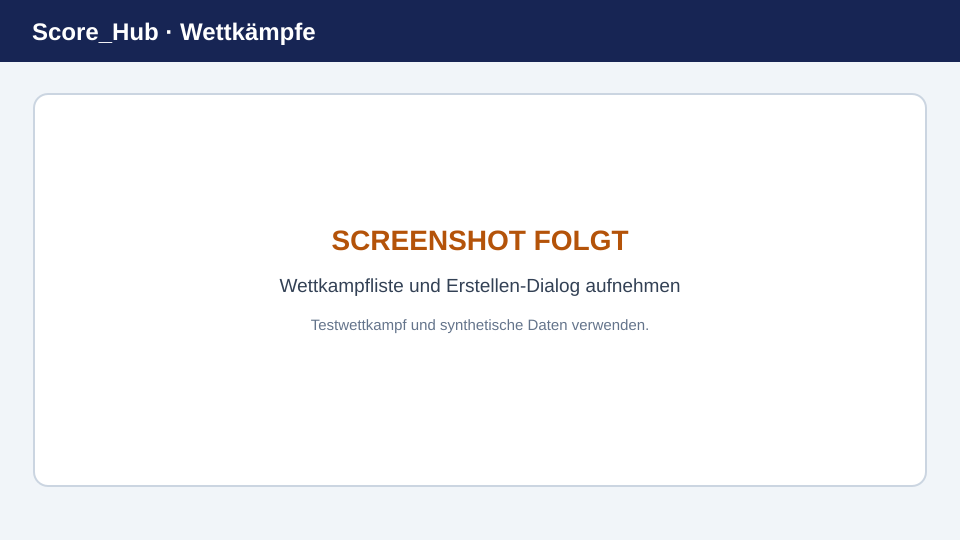

# Wettkampf erstellen

Wettkämpfe werden im Vereinsbereich verwaltet. Zum Anlegen oder Ändern benötigen Sie die entsprechende Vereins- oder Systemberechtigung.

> **Platzhalterbild:** Ersetzen Sie diese Grafik durch einen aktuellen Screenshot. Details: [Screenshots ersetzen](../screenshots.md).

## Neuen Wettkampf anlegen

1. Öffnen Sie **Verein → Wettkämpfe**.
2. Wählen Sie die Aktion zum Erstellen eines Wettkampfs.
3. Tragen Sie die angezeigten Grunddaten ein. Dazu gehören insbesondere Name, Kurzname, Beschreibung, Typ, Status, Disziplin und Start- beziehungsweise Enddatum.
4. Speichern Sie den Wettkampf. Er erscheint danach in der Vereinsliste.
5. Öffnen Sie die Konfiguration des Wettkampfs, um Kategorien, Resultatfelder, Auszeichnungen, Abrechnung, Runden, Ranglisten und Wettkampfbenutzer einzurichten.

Die konkreten Pflichtfelder sind im Formular markiert. Veröffentlichen oder ändern Sie den Status erst, wenn die Konfiguration für Ihren Ablauf stimmt.

## Wettkampftypen

Die Anwendung stellt Einzel-, Gruppen- und gemischte Wettkampftypen zur Auswahl. Die dazugehörigen Ranglisten und Gruppen richten sich nach dem gewählten Typ und der Konfiguration.

## Nach dem Anlegen

- Ergänzen Sie zuerst die Konfiguration, insbesondere Runden, Kategorien und Resultatfelder.
- Fügen Sie im Bereich **Schützen** Teilnehmende hinzu.
- Erstellen und belegen Sie bei Gruppenwettkämpfen die benötigten Gruppen.
- Vergeben Sie Wettkampfrollen nur an die Personen, die den jeweiligen Zugriff benötigen.

Weiter: [Wettkampf konfigurieren](competition-settings.md) · [Teilnehmer verwalten](manage-participants.md) · [Resultate erfassen](../results/quick-start.md)
