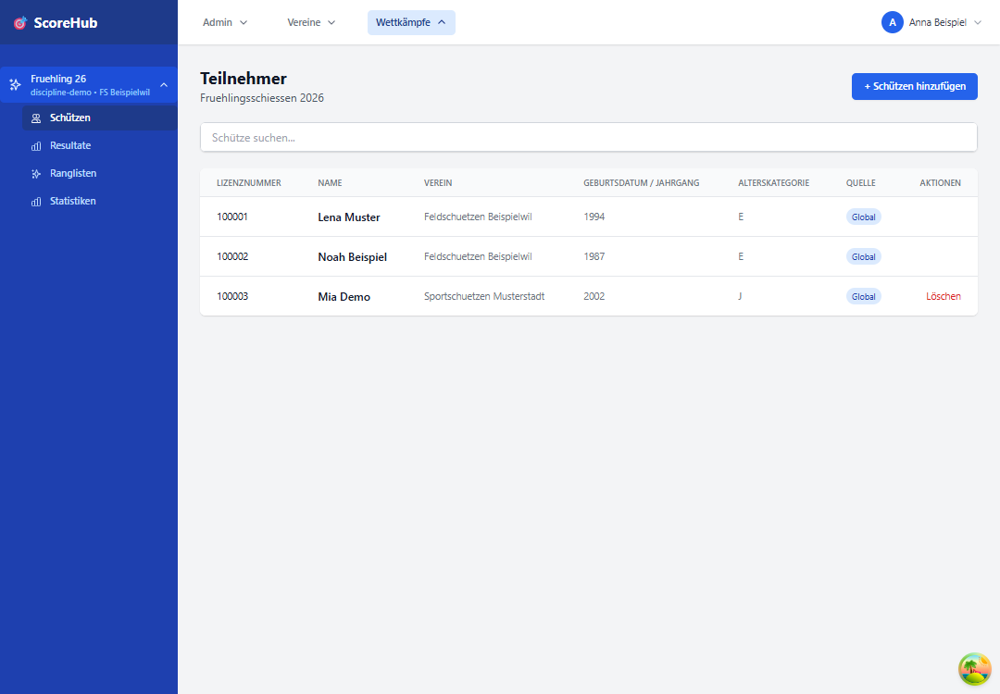
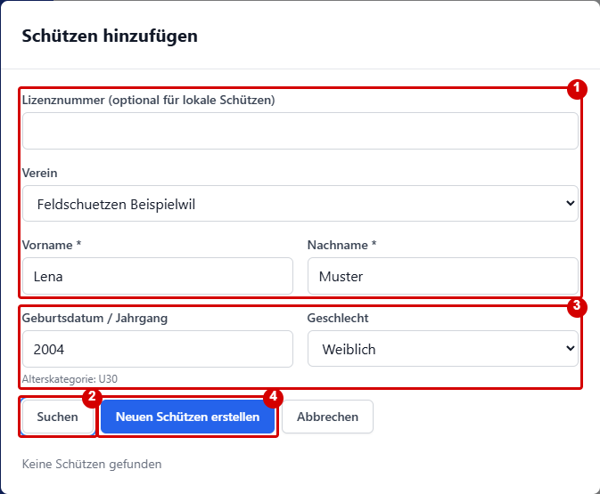
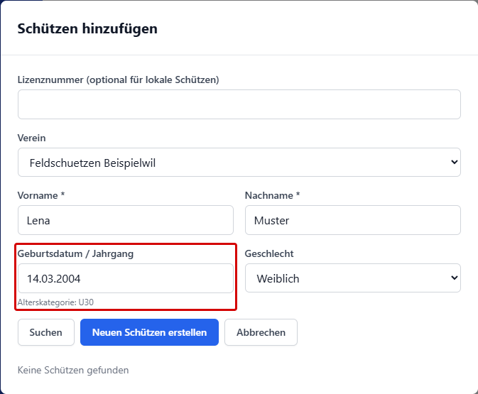

# Schützen, Teilnehmer und Gruppen

Die Teilnehmer eines Wettkampfs werden im Bereich **Schützen** verwaltet. Gruppen und deren Belegung werden im separaten Bereich **Gruppen** gepflegt.

## Schützen hinzufügen

1. Öffnen Sie den Wettkampf und wechseln Sie zu **Schützen**.
2. Wählen Sie **Schützen hinzufügen** und suchen Sie im Dialog nach einem vorhandenen Schützen.
3. Wählen Sie den passenden Eintrag aus den Suchergebnissen und fügen Sie ihn dem Wettkampf hinzu. Prüfen Sie anschliessend die Teilnehmerliste.

### Neuen Schützen erfassen

Ist kein passender Schütze vorhanden, können Sie ihn direkt im Dialog erstellen, sofern die Neuerfassung für den Wettkampf freigeschaltet ist. Der Zugang hängt von Ihrer Rolle ab. Die Abbildungen zeigen frei erfundene Daten; die roten Markierungen wurden für diese Anleitung ergänzt.

1. Geben Sie Vor- und Nachname ein und wählen Sie bei Bedarf den Verein. Die Lizenznummer ist für lokale Schützen optional.
2. Wählen Sie **Suchen**, um vorhandene Einträge zu prüfen. Gibt es einen passenden Treffer, wählen Sie ihn aus, statt einen doppelten Eintrag zu erstellen.
3. Falls kein Treffer passt, ergänzen Sie den Jahrgang oder das Geburtsdatum sowie bei Bedarf das Geschlecht. Die angezeigte Alterskategorie wird anhand des Jahrgangs ermittelt.
4. Wählen Sie **Neuen Schützen erstellen**. Prüfen Sie anschliessend den Eintrag in der Teilnehmerliste.

### Geburtsdatum oder Jahrgang

Im Feld **Geburtsdatum / Jahrgang** sind beide Eingaben möglich:

- Nur der vierstellige Jahrgang, zum Beispiel `2004`: Beim Speichern wird automatisch der **01.01.2004** als Geburtsdatum verwendet.
- Das vollständige Datum, zum Beispiel `14.03.2004`: Dieses Datum wird beim Speichern übernommen. Auch `2004-03-14` ist möglich.

Für die Alterskategorie wird derzeit nur das Geburtsjahr benötigt. Das Feld darf leer bleiben; dann wird keine Alterskategorie aus dem Geburtsdatum vorgeschlagen. Ungültige Daten oder Jahrgänge ausserhalb von 1900 bis zum aktuellen Jahr werden im Dialog beanstandet.

Der Import von Teilnehmerlisten aus Excel oder CSV ist kein Bestandteil dieses Ablaufs.

## Schützendaten bearbeiten oder entfernen

Wählen Sie den Schützen in der Liste und verwenden Sie die angebotene Bearbeitungsaktion. Bei bereits erfassten Resultaten können Änderungen oder das Entfernen eingeschränkt sein. Ändern Sie Stammdaten sorgfältig, weil sie in Resultaten und Ranglisten verwendet werden können.

## Gruppen bilden

1. Wechseln Sie zu **Gruppen**.
2. Wählen Sie bei Bedarf die Kategorie und Runde.
3. Erstellen Sie eine Gruppe mit einem eindeutigen Namen.
4. Fügen Sie die passenden Wettkampfschützen der Gruppe hinzu.
5. Kontrollieren Sie die Zuordnung für jede relevante Runde und Kategorie.

Die Gruppenbelegung kann je nach Wettkampfkonfiguration pro Runde und Kategorie verwaltet werden. Prüfen Sie vor der Resultaterfassung, dass die Zuordnungen stimmen.

Weiter: [Wettkampf konfigurieren](competition-settings.md) · [Resultate erfassen](../results/quick-start.md)
