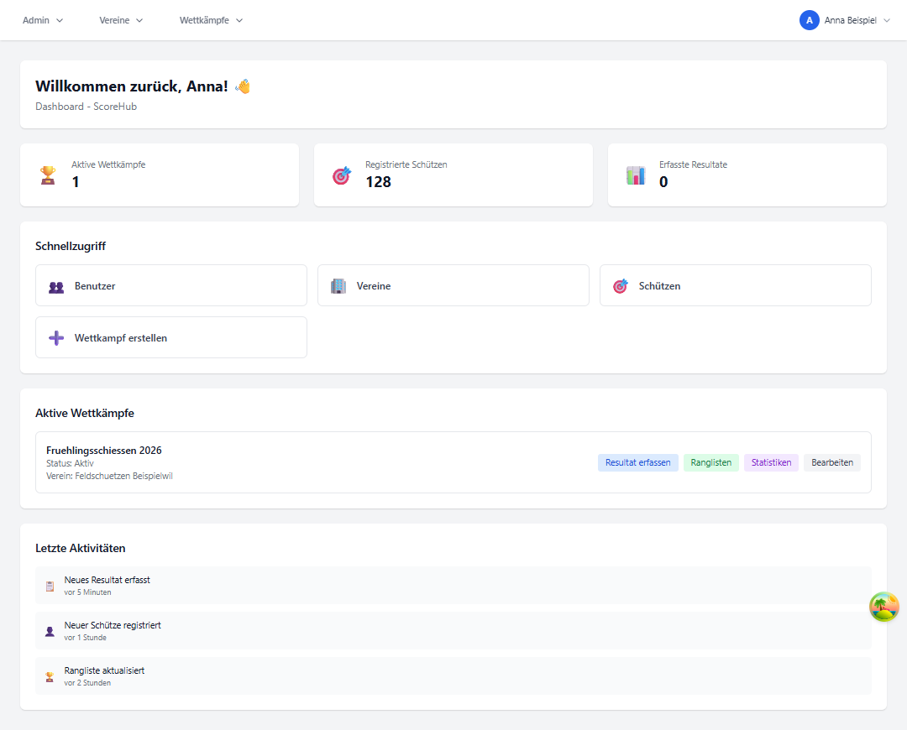

# Dashboard und Navigation

Das Dashboard ist die Startseite nach der Anmeldung. Es zeigt Kennzahlen, Schnellaktionen und die Wettkämpfe, die für Ihr Konto verfügbar sind.

## Bereiche des Dashboards

- **Aktive Wettkämpfe:** Liste der für Sie verfügbaren Wettkämpfe mit Status und – wenn vorhanden – Vereinsname.
- **Schnellaktionen:** Die angezeigten Aktionen hängen von Ihrer Rolle ab. Administratoren sehen zusätzliche Verwaltungslinks.
- **Kennzahlen:** Die angezeigten Gesamtwerte sind Systemübersichten. Derzeit ist die Kennzahl für Resultate noch nicht angebunden und kann daher `0` anzeigen; sie ist nicht als vollständiger Resultat-Zähler zu verstehen.

Öffnen Sie bei einem Wettkampf über die angebotenen Aktionen den Resultatbereich oder die Rangliste. Für die Konfiguration eines Wettkampfs wechseln Sie zum Vereinsbereich und öffnen **Wettkämpfe**.

## Navigation

Die Seitenleiste gruppiert die verfügbaren Bereiche. Je nach Berechtigung sehen Sie unter anderem:

- **Verein:** Stammdaten, Vereinsbenutzer, Standorte und Wettkämpfe
- **Wettkämpfe:** Teilnehmer, Gruppen, Resultate, Ranglisten und Statistiken des geöffneten Wettkampfs
- **Administration:** systemweite Benutzer-, Vereins- und Stammdatenverwaltung; nur für Systemadministratoren
- **Profil und Sprache:** persönliche Angaben sowie Sprachwahl

Auf kleinen Bildschirmen kann die Seitenleiste eingeklappt sein. Verwenden Sie die Schaltfläche für die Navigation, um sie zu öffnen.

Weiter: [Rollen](roles.md) · [Wettkampf erstellen](../competitions/create-competition.md)
