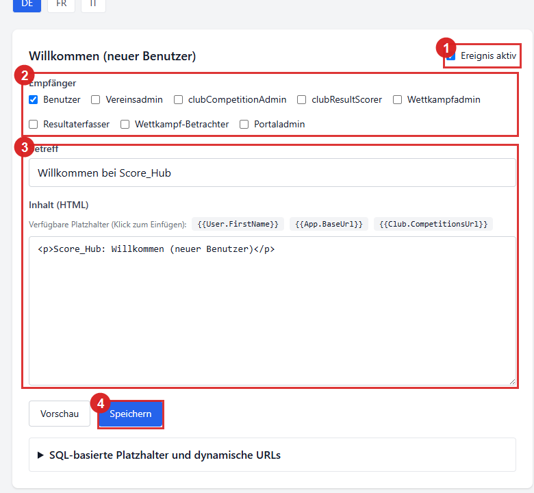
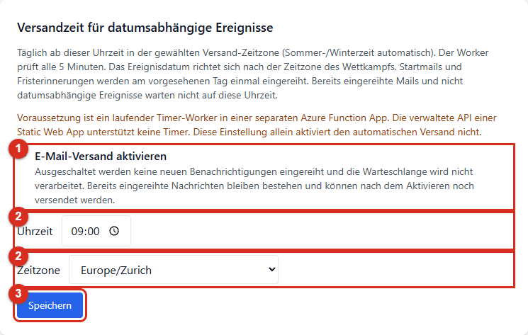
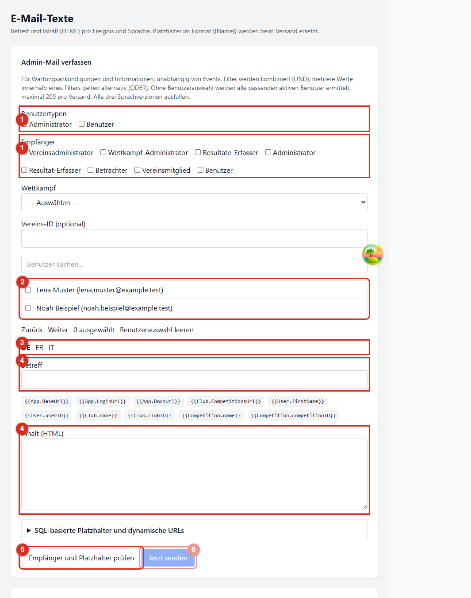

# Benachrichtigungen und Admin-Mails

Score_Hub verschickt automatische E-Mails bei bestimmten Konto- und Wettkampfereignissen. Systemadministratoren können Ereignisse, Empfängerrollen und Texte konfigurieren. Für manuelle Mitteilungen gibt es zusätzlich den separaten Admin-Maildialog.

*1 schaltet das Ereignis ein oder aus, 2 legt Empfängerrollen fest, 3 markiert Betreff und HTML-Inhalt und 4 speichert die Vorlage.*

## Ereignisse, Auslöser und Empfänger

Die folgende Tabelle zeigt die Ereignisse und die standardmässig eingeschalteten Empfängerrollen. Die Rollen lassen sich pro Ereignis unter **E-Mail-Texte** konfigurieren. Empfangen können aktive Benutzer, die im betroffenen Verein oder Wettkampf die ausgewählte Rolle haben.

| Ereignis | Wann wird es ausgelöst? | Standardempfänger |
| --- | --- | --- |
| Willkommen | Bei der Registrierung oder beim Erstellen eines Benutzerkontos | Der neue Benutzer |
| Verein: Benutzer hinzugefügt | Wenn ein Benutzer einem Verein zugeordnet wird | Der hinzugefügte Benutzer |
| Verein: Rolle entfernt | Wenn eine Vereinsrollenzuweisung entfernt wird | Der betroffene Benutzer |
| Wettkampf: Benutzer hinzugefügt | Wenn ein Benutzer einem Wettkampf zugeordnet wird | Der hinzugefügte Benutzer |
| Wettkampf: Rolle geändert | Wenn beim Übernehmen von Wettkampfbenutzern aus einer Vorlage die Rolle des erstellenden Benutzers auf Wettkampfadministration angepasst wird | Der betroffene Benutzer |
| Ergebniserfassung gestartet | Am **Erfassungsstartdatum** des Wettkampfs, falls dort die Startbenachrichtigung eingeschaltet ist | Systemadministration, Vereinsadministration des organisierenden Vereins, Wettkampfadministration, Resultaterfassung und Lesende des Wettkampfs |
| Erfassungsfrist läuft ab | Sieben Tage vor der **Erfassungsfrist** des Wettkampfs, falls dort die Fristerinnerung eingeschaltet ist | Systemadministration, Vereinsadministration des organisierenden Vereins und Wettkampfadministration |

Die beiden letzten Termine beziehen sich auf das **Erfassungsstartdatum** und die **Erfassungsfrist**, nicht auf das Start- oder Enddatum des Wettkampfs. Beide Benachrichtigungen müssen an zwei Stellen aktiv sein: Das Ereignis muss unter **E-Mail-Texte** eingeschaltet sein und die entsprechende Option muss in der Wettkampfkonfiguration **Allgemein** aktiviert sein. Die Erfassungsfrist wird nur erinnert, wenn sie gesetzt ist.

Benutzer- und Rollenzuweisungsereignisse gehen an das betroffene Konto. Die Empfängerrollen des Ereignisses bestimmen bei diesen persönlichen Zuweisungsmeldungen, ob die Meldung für den Benutzer aktiv ist. Die Ereignis- und Empfängerregeln für Fristenmeldungen werden unabhängig davon konfiguriert.

## Automatische Ereignisse konfigurieren

1. Öffnen Sie als Systemadministrator **Administration → E-Mail-Texte**.
2. Klappen Sie das gewünschte Ereignis durch Klicken auf seine Überschrift auf. Mit **Ereignis aktiv** schalten Sie dieses Ereignis systemweit ein oder aus.
3. Wählen Sie unter **Empfänger** die Rollen aus, die die Meldung erhalten sollen.
4. Wählen Sie **de**, **fr** und **it** und pflegen Sie für jede Sprache Betreff und HTML-Inhalt. Die Sprache des Empfängers bestimmt, welche Vorlage verwendet wird.
5. Verwenden Sie die angebotenen Platzhalter-Schaltflächen, um Werte wie `{{User.FirstName}}` oder `{{Competition.Name}}` an der Cursorposition einzufügen.
6. Prüfen Sie die Vorlage mit **Vorschau** und speichern Sie die Änderungen für das Ereignis.

Ein ausgeschaltetes Ereignis reiht keine neuen Meldungen ein. Änderungen an Vorlagen betreffen künftige Nachrichten; bereits für den Versand vorbereitete Nachrichten behalten ihren gerenderten Inhalt.

### Versandzeit für datumsabhängige Ereignisse

Im Feld **Versandzeit für datumsabhängige Ereignisse** stellen Sie eine systemweite Uhrzeit und Versand-Zeitzone ein. Standard ist **09:00 / Europe/Zurich**. Der Timer prüft alle fünf Minuten und reiht Start- und Fristerinnerungen ab der gewählten Uhrzeit am jeweiligen Ereignistag ein. Der Ereignistag richtet sich nach der Zeitzone des Wettkampfs; die Uhrzeit nach der hier ausgewählten Versand-Zeitzone. Eine Änderung der Uhrzeit oder Zeitzone versendet bereits eingereihte Ereignisse nicht erneut.

*1 pausiert oder aktiviert den E-Mail-Versand global, 2 legt Versandzeit und Zeitzone fest und 3 speichert die Einstellungen.*

Willkommens- und Zuweisungsmeldungen sowie manuelle Admin-Mails warten nicht auf diese tägliche Versandzeit. Die tatsächliche Zustellung kann durch die Warteschlange oder den Mailanbieter verzögert werden.

**Betriebsvoraussetzung:** Der Timer muss in einer separaten Azure Function App betrieben werden. Die verwaltete API einer Azure Static Web App unterstützt keine Timer. Die Einstellung der Versandzeit richtet den Worker nicht selbst ein.

### Versandübersicht und Workerprüfung

Die **Versandübersicht** zeigt versendete, wartende, in Verarbeitung befindliche, erneut versuchte, fehlgeschlagene und zur Prüfung angehaltene Mailzustellungen. Klicken Sie auf einen Statuszähler, um die letzten 100 passenden Zustellungen anzuzeigen. **Versendet** bedeutet vom Mailprovider angenommen, nicht bestätigter Eingang im Postfach.

Die Übersicht prüft jede Minute den aktuellen Worker-Lebensnachweis. Ein abgelaufener Nachweis, ein fehlgeschlagener Lauf oder eine erkannte Fehlkonfiguration wird als Fehler angezeigt. Fehlt der Nachweis oder die Leseberechtigung, wird ausdrücklich **Worker kann nicht geprüft werden** gemeldet. **Synchronisiert** allein beweist nicht, dass der Worker aktuell läuft.

### Synchronisationsstatus nach Änderungen

Nach dem Speichern zeigt der Bereich den Status der Synchronisierung mit dem Benachrichtigungs-Worker. **Synchronisiert** bedeutet, dass die gespeicherte Revision übernommen wurde. Bei **Ausstehend** oder **Fehler** ist die Änderung zwar gespeichert, aber noch nicht wirksam.

Mit **Synchronisierungsstatus aktualisieren** können Sie den Status manuell neu laden. Dabei werden keine ungespeicherten Eingaben überschrieben; eine automatische Statusabfrage gibt es nicht. Wenn die Synchronisierung aussteht oder fehlgeschlagen ist, können Sie mit **Synchronisierung reparieren** die gespeicherte Konfiguration erneut veröffentlichen und anschliessend den Status prüfen. Ungespeicherte Eingaben werden dabei nicht gespeichert. Eine erfolgreiche Veröffentlichung bestätigt weder, dass die Einstellungen bereits wirksam sind, noch dass eine E-Mail zugestellt wurde.

Eine geänderte Versandzeit gilt erst nach erfolgreicher Synchronisierung. Bereits eingereihte Nachrichten werden dadurch nicht erneut erstellt. Die Uhrzeit bezeichnet den geplanten Verarbeitungsbeginn, nicht eine garantierte Zustellminute. Manuelle Admin-Mails und persönliche Willkommens- oder Zuweisungsmeldungen warten nicht auf diese tägliche Versandzeit.

### E-Mail-Versand global pausieren

Mit **E-Mail-Versand aktivieren** im Versandzeit-Bereich schaltet die Systemadministration den E-Mail-Ausgang global ein oder aus. Bei ausgeschaltetem Versand werden keine neuen E-Mails eingereiht und wartende E-Mails nicht verarbeitet. Bereits eingereihte E-Mails bleiben erhalten und können nach dem erneuten Aktivieren weiterverarbeitet werden. Vorschau und Empfängerprüfung von Admin-Mails bleiben möglich.

### Dashboard-Benachrichtigungen, Aufbewahrung und E-Mail-Modus

Mit **Dashboard-Benachrichtigungen aktivieren** wird der Dashboard-Eingang als zusätzlicher Zustellkanal eingeschaltet. Admin-Mitteilungen können damit auch dann im Dashboard bereitgestellt werden, wenn der E-Mail-Versand ausgeschaltet ist. Sind sowohl E-Mail als auch Dashboard-Benachrichtigungen ausgeschaltet, ist der Versand gesperrt.

Im Dashboard steht jede Nachricht als kompakte Betreffzeile in einer Liste. **Öffnen** oder ein Doppelklick öffnet den HTML-Inhalt im Dialog und markiert die Nachricht als gelesen. Bei einem Fehler erscheint eine Meldung; der Lesestatus wird nicht vorzeitig geändert.

Unter **Gelesene Benachrichtigungen aufbewahren (Tage)** legen Sie eine Frist von **1 bis 365 Tagen** fest; standardmässig sind es 30 Tage. Gelesene Dashboard-Mitteilungen werden nach Ablauf der Frist gelöscht, ungelesene bleiben erhalten. Eine verkürzte Frist kann bei der nächsten Bereinigung bereits vorhandene gelesene Mitteilungen unwiderruflich löschen.

Der **E-Mail-Modus** steuert die Kennzeichnung des E-Mail-Inhalts: **DEV** und **TEST** fügen einen Hinweis zu Betreff und Inhalt hinzu; **PROD** versendet die Vorlage unverändert. Prüfen Sie den Modus vor dem Aktivieren des produktiven Versands.

## Platzhalter in Vorlagen

Die kompakte Liste **Verwendete Platzhalter** zeigt pro Token eine Zeile: Platzhalter aus den Sprachvorlagen und ausdrücklich angelegte eigene Definitionen. **Platzhalter hinzufügen** öffnet einen Dialog, in dem Sie verfügbare Ereignis-, Benutzer- und Linkplatzhalter suchen und per **Einfügen** auswählen können. Der Token wird an der Cursorposition im zuletzt verwendeten Betreff- oder Inhaltsfeld eingefügt. **Kopieren** legt ihn in die Zwischenablage. Eigene Definitionen bearbeiten Sie im Dialog über **Bearbeiten**; ihr Tokenname bleibt erhalten.

Im selben Dialog können Sie unter **Eigenen Platzhalter konfigurieren** bis zu 50 zusätzliche Werte pro Vorlage erstellen. Es werden keine eigenen Definitionen vorab angelegt. Der Name wird beim Erstellen automatisch aus der Definition gebildet:

- **Feld:** Liest ein einzelnes Feld aus einer angebotenen Tabelle.
- **Anzahl (COUNT):** Zählt passende Datensätze; eine leere Ergebnismenge ergibt `0`.
- **Dynamische URL:** Erstellt einen Link mit Anwendungs- oder Dokumentationsbasis, relativem Pfad und optionalem Anker.

Jede SQL-Abfrage benötigt mindestens einen Kontextfilter. Als Kontext dienen die Benutzer-ID des Empfängers, eine Vereins-ID oder eine Wettkampf-ID; bis zu drei Filter werden gemeinsam angewendet. Ein einzelnes Feld muss genau einen Datensatz ergeben. Sensible Felder werden nicht angeboten. Dynamische URLs verwenden eine Anwendungs- oder Dokumentationsbasis sowie einen relativen Pfad, optional mit Anker. Testen Sie Betreff und Inhalt mit den tatsächlichen Ereigniswerten, bevor Sie die Vorlage speichern.

## Admin-Mail manuell versenden

*1 markiert Benutzertypen und Rollen, 2 die Einzelauswahl, 3 die Sprachwahl, 4 Betreff und Inhalt, 5 die Empfänger- und Platzhalterprüfung und 6 das Einreihen zum Versand. Der Versand bleibt ohne gültige Vorschau gesperrt.*

1. Öffnen Sie **Administration → E-Mail-Texte** und den Bereich **Direkt an Benutzer senden**.
2. Wählen Sie mindestens eine Zielgruppe: einzelne Benutzer, System-Benutzertypen, Vereins- oder Wettkampfrollen sowie optional einen Wettkampf oder eine Vereins-ID.
3. Pflegen Sie Betreff und Inhalt für Deutsch, Französisch und Italienisch. Pro Empfänger wird die Vorlage seiner bevorzugten Sprache verwendet.
4. Fügen Sie benötigte Platzhalter ein und wählen Sie **Empfänger und Platzhalter prüfen**.
5. Prüfen Sie die gerenderte Vorschau für jeden Empfänger. Fehlende, leere oder mehrdeutige Platzhalter blockieren den Versand.
6. Wählen Sie **Jetzt senden**. Die Empfänger und der fertig gerenderte Inhalt werden in die Versandwarteschlange übernommen.

Verschiedene Filter schränken die Zielgruppe gemeinsam ein (UND); mehrere Werte innerhalb eines Filters gelten alternativ (ODER). Wenn keine einzelnen Benutzer markiert sind, werden alle aktiven Benutzer berücksichtigt, die den übrigen ausgewählten Filtern entsprechen. Pro Versand sind höchstens 200 Empfänger zulässig. Mindestens ein Zielgruppenfilter ist erforderlich.

Admin-Mails sind manuelle Mitteilungen, keine automatischen Ereignisse. Ihre Vorschau und das Einreihen hängen nicht von der täglichen Versandzeit ab; der globale E-Mail-Schalter muss für das tatsächliche Versenden eingeschaltet sein. Die Erfolgsmeldung bestätigt die Einreihung, nicht die Zustellung.

## Persönliche Einstellungen und Zeitzonen

Individuelle Einstellungen für einzelne Ereignisse werden bei der Empfängerauswahl berücksichtigt. In der Anwenderoberfläche gibt es derzeit jedoch keine Profilseite, auf der Benutzer diese Ereigniseinstellungen selbst ändern können. Die Empfängerrollen für automatische Ereignisse verwaltet die Systemadministration.

Die Zeitzone im persönlichen Profil beeinflusst die Anzeige konkreter Zeitpunkte. Für datumsabhängige Benachrichtigungen gilt dagegen der lokale Kalendertag des Wettkampfs; die tägliche Versandzeit verwendet die separate, systemweite Versand-Zeitzone. Datumsgrenzen für Resultateingaben sind inklusive und werden anhand der Wettkampfzeitzone geprüft. Resultaterfassende können während dieses Fensters Resultate anlegen, ändern und löschen. Eine fehlende Grenze lässt das Fenster offen; abgeschlossene oder abgesagte Wettkämpfe bleiben gesperrt.

Weiter: [Rollen und Berechtigungen](getting-started/roles.md) · [Wettkampf konfigurieren](competitions/competition-settings.md)
