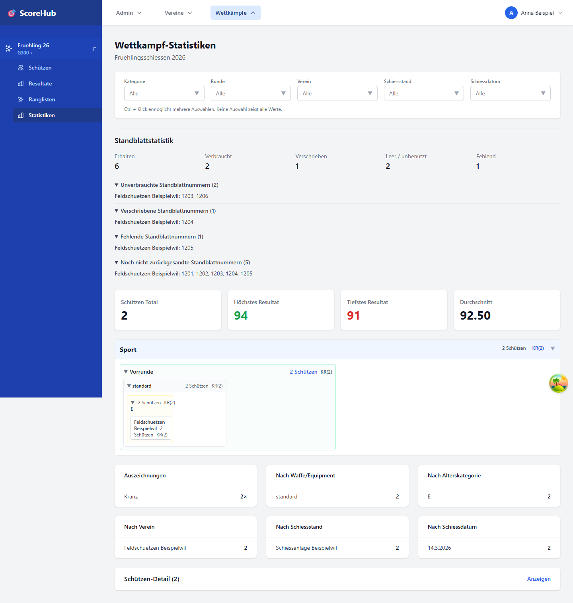

# Wettkampfstatistiken

Die Seite **Statistiken** fasst die Resultate des geöffneten Wettkampfs zusammen. Welche Auswertungen erscheinen, hängt von vorhandenen Resultaten und den verfügbaren Filtern ab.

## Statistiken lesen

1. Öffnen Sie den Wettkampf und wählen Sie **Statistiken**.
2. Wählen Sie verfügbare Filter wie Kategorie, Verein, Standort oder Schiesstag.
3. Prüfen Sie Kennzahlen und Tabellen im Zusammenhang mit der gewählten Auswahl.

Leere Bereiche bedeuten nicht zwingend, dass der Wettkampf keine Resultate enthält. Prüfen Sie zuerst Filter und Kategorie. Kennzahlen sind nur für die in der Anwendung dargestellten Daten und Auswahlbereiche gültig.

## Standblatt-Bestand und Rücklauf

Bei aktiviertem [Standblatt-Tracking](../competitions/data-sheet-tracking.md) zeigt die Statistik die erhaltenen, verbrauchten, verschriebenen, leeren und ausdrücklich fehlenden Blätter. Aufklappbare Listen nennen die unverbrauchten, verschriebenen, fehlenden und noch nicht zurückgesandten Nummern. Der Vereinsfilter schränkt diese Mengen und Listen ebenfalls ein; eingeschränkte Resultaterfassende sehen nur ihren Verein.

Verbrauch und Rücklauf sind unabhängig: Ein Blatt mit Resultat kann noch nicht zurückgesandt sein. Ein leer zurückgesandtes Blatt zählt weiterhin als leer, aber nicht mehr als offene Rückgabe. Den tatsächlichen Rücklauf bucht die Wettkampfverwaltung unter **Konfiguration → Abrechnung** mit konkreten Nummern.

Wenn **Abrechnung als PDF** freigeschaltet ist, übernimmt der Ausdruck die vereinsgefilterten Standblatt-Anzahlen, einschliesslich Verschrieben, Leer und offenem Rücklauf. Nummernlisten werden nicht gedruckt.

## PDF-Ausgabe

Falls die Seite eine PDF-Aktion anbietet, kontrollieren Sie die Auswahl und Filter vor dem Erstellen der Datei. Für weitere Auswertungen verwenden Sie die zugrunde liegenden Resultate oder wenden Sie sich an die Wettkampfadministration.

## PDF-Batch als ZIP

Wenn **Abrechnung als PDF** freigeschaltet ist, erscheint daneben **PDF-Batch (ZIP)**. Standardmässig erstellt der Dialog ein Abrechnungs-PDF pro Verein, mit allen ausgewählten Kategorien gemeinsam. Vereine mit Standblattdaten erhalten auch ohne passende Resultate ein eigenes Blatt zur Abrechnungskontrolle.

1. Setzen Sie zuerst die gewünschten Filter auf der Statistikseite.
2. Öffnen Sie **PDF-Batch (ZIP)** und wählen Sie die Gruppierung: Verein, Kategorie, Runde, Schiessstand oder Schiessdatum. Mehrere ausgewählte Merkmale werden kombiniert.
3. Aktivieren Sie bei Bedarf die **Gesamt-PDF**-Option. Sie erstellt ein zusätzliches Abrechnungs-PDF ohne diese Gruppierungen, aber mit den aktuellen Filtern.
4. Laden Sie das ZIP mit den einzelnen PDFs herunter.

Reine Vereins- und Gesamtblätter enthalten die zugehörigen Standblattmengen und Kosten. Sobald Kategorie, Runde, Schiessstand oder Datum als Gruppierung gewählt ist, entstehen **statistische Auswertungen, keine Abrechnungen**: Geldbeträge fehlen, nicht zuordenbare Standblattmengen stehen auf **0**. Aus Resultaten ableitbarer Verbrauch und Munitionsmengen bleiben sichtbar. Vereine ohne passende Resultate erhalten zusätzlich ein reines Vereinsblatt, statt einer erfundenen Unterteilung.

Nur Merkmale mit mindestens zwei sichtbaren Werten sind auswählbar. Eingeschränkte Resultaterfassende exportieren ausschliesslich ihren eigenen Verein; **Verein** bleibt für sie ausgegraut. Die Einschränkung gilt auch für Standblattdaten und das Gesamt-PDF.

Weiter: [Ranglisten ansehen](view-rankings.md)
