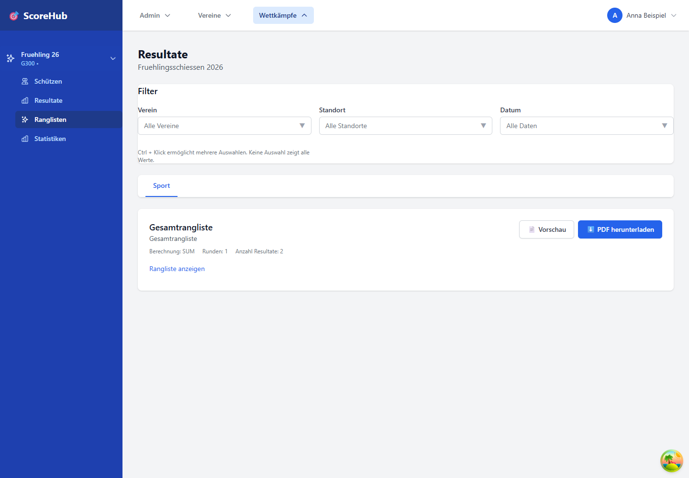

# Ranglisten ansehen

Die Ranglisten eines Wettkampfs finden Sie im Bereich **Ranglisten**. Die angezeigten Wertungen richten sich nach den Ranglisten, Kategorien und Resultaten, die für diesen Wettkampf konfiguriert wurden.

## Rangliste auswählen und filtern

1. Öffnen Sie den Wettkampf und wählen Sie **Ranglisten**.
2. Wählen Sie die Kategorie und – sofern verfügbar – die Rangliste.
3. Verwenden Sie verfügbare Filter, etwa Verein, Standort oder Schiesstag.
4. Prüfen Sie die Resultate und die angezeigte Platzierung.

Eine Rangliste kann leer sein, wenn noch keine passenden Resultate erfasst wurden oder Filter keine Treffer liefern. Setzen Sie Filter zurück und prüfen Sie, ob die Wettkampfadministration die Rangliste konfiguriert hat.

Die Sortierfelder werden in der konfigurierten Reihenfolge angewendet. Numerische Zusatzfelder verwenden dieselbe Gesamtberechnung für Anzeige und Sortierung: Summe, Durchschnitt oder den Wert der Runde mit dem besten Resultat. Bei mehreren gleich guten Resultaten zählt die erste passende Runde. Fehlt dort ein numerischer Zusatzwert, wird er als 0 angezeigt und sortiert.

## Rangliste als PDF speichern

Wenn für Ihre Rolle verfügbar, verwenden Sie die PDF-Aktion der Rangliste. Prüfen Sie vor dem Export die ausgewählte Kategorie und Filter. Weitere Exportformate wie Excel oder CSV werden in dieser Anleitung nicht vorausgesetzt.

## Mehrere Ranglisten als ZIP speichern

Für einen direkten Export klicken Sie bei der gewünschten Rangliste auf **PDF alle Kategorien**. Ohne weiteren Dialog wird ein ZIP mit genau einem PDF je Kategorie mit Resultaten heruntergeladen. Vereins-, Schiessstand- und Datumsfilter sowie Einschränkungen auf den eigenen Verein werden übernommen; der aktive Kategorie-Tab begrenzt diesen Export nicht. Leere Kategorien werden übersprungen. Während der Erstellung wird der Fortschritt angezeigt.

Für eine zusätzliche Aufteilung nach Verein, Schiessstand oder Datum verwenden Sie den Batch-Export:

Der Dialog bietet nur Aufteilungen mit mindestens zwei unterschiedlichen Werten in den für Sie sichtbaren, aktuell gefilterten Daten an. Andere Merkmale sind ausgegraut und nicht anwählbar. Dürfen Sie nur Resultate des eigenen Vereins sehen, bleibt **Verein** immer deaktiviert. Diese Berechtigung gilt für das Laden der Optionen, jede einzelne PDF-Datei, die Gesamtranglisten und **PDF alle Kategorien**. Ohne aktuellen Verein ist für eingeschränkte Erfasser kein Export möglich. Sind alle Merkmale deaktiviert, können Sie weiterhin die Gesamtranglisten pro Kategorie exportieren.

1. Klicken Sie bei der gewünschten Rangliste auf **Batch-Export**.
2. Wählen Sie unter **Rangliste pro** Verein, Schiessstand und/oder Schiessdatum. Kategorien werden immer automatisch getrennt: Pro Verein entsteht beispielsweise für jede Kategorie mit Resultaten ein PDF. Mehrere Merkmale erzeugen ein PDF je vorhandener Kombination und Kategorie.
3. Aktivieren oder deaktivieren Sie **Gesamtrangliste pro Kategorie zusätzlich einschliessen**. Damit entsteht für jede Kategorie mit Resultaten zusätzlich ein PDF ohne die gewählte Aufteilung.
4. Klicken Sie auf **ZIP herunterladen**. Nach der Erstellung aller PDFs wird eine ZIP-Datei zum Speichern heruntergeladen.

Der Batch-Export umfasst alle Kategorien unabhängig vom gewählten Kategorie-Tab. Die übrigen Filter gelten für alle PDFs, auch für die Gesamtranglisten. Einschränkungen auf den eigenen Verein bleiben bestehen. Kategorien und Kombinationen ohne Resultate werden übersprungen. Fehlt bei einem Resultat eine Kategorie oder ein gewähltes Merkmal, erscheint eine Fehlermeldung; ergänzen Sie die Daten oder ändern Sie die Aufteilung. Bei einem Exportfehler wird kein unvollständiges ZIP heruntergeladen. Die bisherigen PDF-Aktionen bleiben verfügbar.

## Ergebnisdetails

Öffnen Sie bei Bedarf eine angebotene Ranglisten-Detailansicht, um die zugehörigen Ergebnisse einzusehen. Ranglisten spiegeln den gespeicherten Datenstand und die Konfiguration wider. Bei einer Abweichung prüfen Sie zuerst Resultate, Kategorie und Filter.

Weiter: [Statistiken](statistics.md) · [Resultate korrigieren](../results/editing-results.md)
