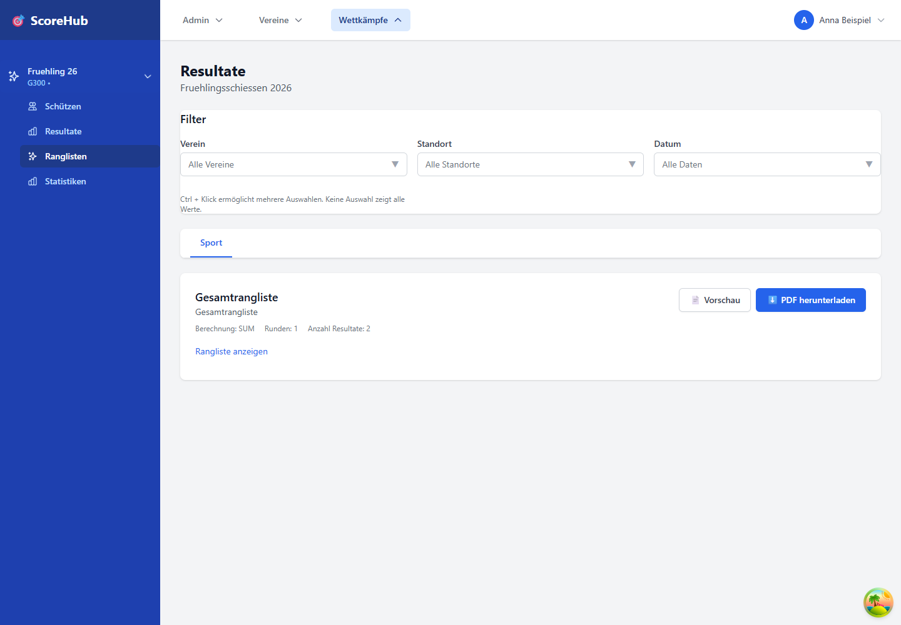

# Ranglisten ansehen

Die Ranglisten eines Wettkampfs finden Sie im Bereich **Ranglisten**. Die angezeigten Wertungen richten sich nach den Ranglisten, Kategorien und Resultaten, die für diesen Wettkampf konfiguriert wurden.

## Rangliste auswählen und filtern

1. Öffnen Sie den Wettkampf und wählen Sie **Ranglisten**.
2. Wählen Sie die Kategorie und – sofern verfügbar – die Rangliste.
3. Verwenden Sie verfügbare Filter, etwa Verein, Standort oder Schiesstag.
4. Prüfen Sie die Resultate und die angezeigte Platzierung.

Eine Rangliste kann leer sein, wenn noch keine passenden Resultate erfasst wurden oder Filter keine Treffer liefern. Setzen Sie Filter zurück und prüfen Sie, ob die Wettkampfadministration die Rangliste konfiguriert hat.

## Rangliste als PDF speichern

Wenn für Ihre Rolle verfügbar, verwenden Sie die PDF-Aktion der Rangliste. Prüfen Sie vor dem Export die ausgewählte Kategorie und Filter. Weitere Exportformate wie Excel oder CSV werden in dieser Anleitung nicht vorausgesetzt.

## Ergebnisdetails

Öffnen Sie bei Bedarf eine angebotene Ranglisten-Detailansicht, um die zugehörigen Ergebnisse einzusehen. Ranglisten spiegeln den gespeicherten Datenstand und die Konfiguration wider. Bei einer Abweichung prüfen Sie zuerst Resultate, Kategorie und Filter.

Weiter: [Statistiken](statistics.md) · [Resultate korrigieren](../results/editing-results.md)
