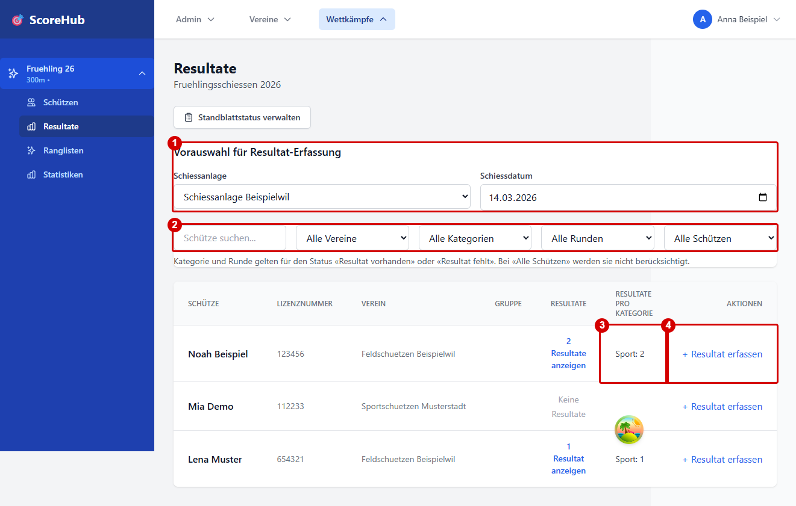
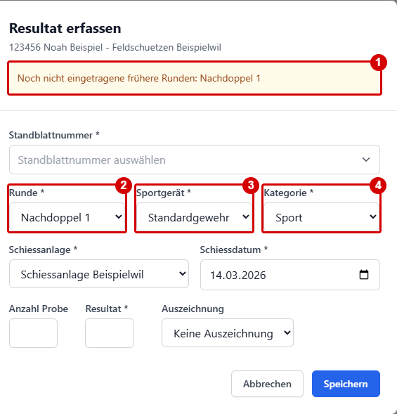
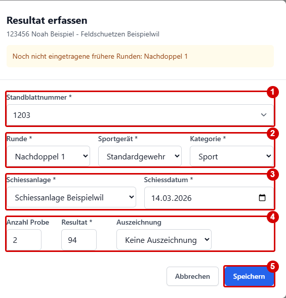

# Resultate und Eingabefelder

Die Resultatmaske wird teilweise durch die Konfiguration des jeweiligen Wettkampfs bestimmt. Erfassen Sie nur Werte gemäss den Wettkampfregeln und den Feldhinweisen in der Anwendung.

## Typische Angaben

Je nach Wettkampf sind unter anderem folgende Angaben verfügbar:

- Runde und Kategorie
- Resultat
- Standort und Schiesstag
- Ausrüstung
- Auszeichnung
- Anzahl Probeschüsse
- zusätzliche, vom Wettkampf definierte Resultatfelder

Nicht alle Angaben sind bei jedem Wettkampf aktiv oder erforderlich. Pflichtfelder und allfällige Höchstwerte werden in der Maske beziehungsweise durch die Validierung angezeigt.

## Resultat erfassen

Öffnen Sie im Wettkampf den Bereich **Resultate**. Die folgenden Beispiele verwenden ausschliesslich frei erfundene Daten; die roten Markierungen wurden für diese Anleitung ergänzt.

### Schützenübersicht und Vorbereitung

1. Wählen Sie bei Bedarf Schiessanlage und Schiessdatum als Vorauswahl für weitere Eingaben.
2. Suchen oder filtern Sie die Schützen nach Verein, Kategorie, Runde und Resultatstatus.
3. Kontrollieren Sie die Anzahl bereits erfasster Resultate pro Kategorie.
4. Öffnen Sie beim gewünschten Schützen **Resultat erfassen**.

### Rundenvorschlag und Lücken

Im Beispiel sind Vorrunde und Nachdoppel 2 bereits erfasst, Nachdoppel 1 aber noch nicht.

1. Der Hinweis nennt die noch fehlende frühere Runde.
2. Die fehlende Runde **Nachdoppel 1** wird vorgeschlagen.
3. Das Sportgerät wird aus der ersten Runde übernommen.
4. Auch die Kategorie wird übernommen. Kontrollieren und ändern Sie die Vorschläge bei Bedarf; die Aufnahme zeigt die Werte vor der manuellen Änderung.

### Felder ausfüllen und speichern

1. Wählen Sie bei aktiviertem Standblatt-Tracking eine gültige **Standblattnummer**.
2. Prüfen Sie Runde, Sportgerät und Kategorie und passen Sie sie bei Bedarf an.
3. Kontrollieren Sie Schiessanlage und Schiesstag.
4. Tragen Sie Resultat und weitere erforderliche Werte ein. Verwenden Sie das Zahlenformat und die Wertung des Wettkampfs.
5. Wählen Sie **Speichern** und prüfen Sie danach den Eintrag in der Übersicht.

Die Anwendung führt eine Eingabevalidierung durch. Eine erfolgreiche Speicherung sollte in der Oberfläche erkennbar sein. Verlassen Sie sich nicht auf automatische Zwischenspeicherung; speichern Sie ausdrücklich über die angebotene Aktion.

Die Anwendung schlägt die tiefste noch fehlende Runde für die bereits in der ersten Runde erfassten Kategorien vor. Dabei übernimmt sie Kategorie und Sportgerät aus der ersten Runde; bei gleichem Rundenstand zuerst die zuerst erfasste Kategorie. Fehlt noch ein Resultat in der ersten Runde, wählen Sie Kategorie und Sportgerät selbst. Wenn alle bekannten Kategorien vollständig sind, bleibt die Runde leer, damit Sie eine weitere Kategorie manuell erfassen können. Sie können die vorgeschlagenen Angaben ändern. Fehlende frühere Runden der gewählten Kategorie werden oben im Dialog angezeigt.

Die Schützenübersicht zeigt die Anzahl erfasster Resultate je Kategorie. Filtern Sie nach Verein, Kategorie und Runde und wählen Sie, ob vorhandene oder fehlende Resultate angezeigt werden. Kategorie und Runde müssen dabei zum selben Resultat gehören; bei **Alle Schützen** werden diese beiden Filter nicht angewendet. Bei eingeschränkten Zugriffsrechten sind Resultate anderer Vereine nicht verfügbar und erscheinen nicht als fehlend.

## Standblatt-Nummer und Status

Wenn das Tracking aktiviert ist, wählen Sie im Resultatdialog zusätzlich eine **Standblatt-Nummer**. Angeboten werden nur verfügbare, noch nicht zurückgesandte Nummern des Vereins, dem der Schütze in der Wettkampf-Schützenliste angehört. Das gilt auch für Wettkampfadministrierende und uneingeschränkte Resultaterfassende. Eingeschränkte Erfassende arbeiten nur für den eigenen Verein.

Auf derselben Seite können Sie im separaten Standblatt-Statusformular Nummern oder Bereiche als **Verschrieben** oder **Fehlend** melden, ohne ein Resultat oder einen Schützen auszuwählen. Den Versand und den physischen Rückversand erfasst dagegen die Wettkampfverwaltung unter **Konfiguration → Abrechnung**.

Anleitung und Rollenmatrix: [Standblatt-Tracking](../competitions/data-sheet-tracking.md).

## Fehler bei der Eingabe

- **Pflichtfeld fehlt:** Ergänzen Sie das markierte Feld.
- **Wert ausserhalb des erlaubten Bereichs:** Prüfen Sie Runde und Kategorien-Einstellungen oder fragen Sie die Wettkampfadministration.
- **Falsche Runde:** Wählen Sie die richtige Runde im Dialog. Ein bereits gespeichertes Resultat können Sie ebenfalls korrigieren.
- **Falscher Schütze:** Brechen Sie ab und wählen Sie den richtigen Schützen.
- **Sie können nicht speichern:** Prüfen Sie Ihre Wettkampfrolle und – falls eingeschränkt – die Vereinszuordnung.

Weiter: [Schnellstart](quick-start.md) · [Resultate korrigieren](editing-results.md)
