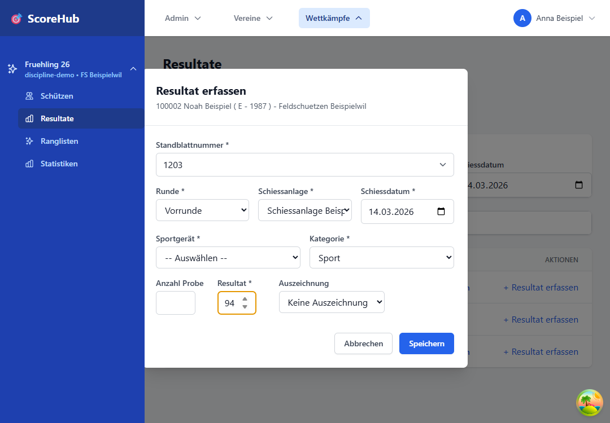

# Resultate – Schnellstart

Diese Anleitung führt durch eine einzelne Resultaterfassung. Sie benötigen Zugriff auf den Wettkampf und die passende Resultaterfassungsrolle.

Für den vollständigen kompakten Ablauf – erster Login, Vereinsdaten, Schützen hinzufügen, Resultate und Rangliste – verwenden Sie den [Kurzstart für Resultaterfassende](../getting-started/result-scorer-quick-start.md).

## In sechs Schritten

1. Öffnen Sie den gewünschten Wettkampf im Dashboard oder in der Navigation.
2. Öffnen Sie **Schützen** und prüfen Sie, ob die Person bereits zum Wettkampf hinzugefügt wurde. Falls nicht, wählen Sie **Schützen hinzufügen**, suchen Sie die Person und fügen Sie sie einmalig hinzu. Dieser Schritt erfolgt im separaten Bereich **Schützen**, nicht unter **Resultate**. Details: [Teilnehmer verwalten](../competitions/manage-participants.md).
3. Wechseln Sie danach zu **Resultate** und suchen Sie den hinzugefügten Schützen.
4. Wählen Sie die passende Runde und Kategorie.
5. Erfassen Sie Resultat und alle als erforderlich markierten Felder, zum Beispiel Standort, Datum, Ausrüstung oder Auszeichnung.
6. Speichern Sie den Eintrag und prüfen Sie, ob er in der Resultatübersicht erscheint.

Die genauen Pflichtfelder hängen von der Konfiguration des Wettkampfs ab. Bei einem Fehler kontrollieren Sie zunächst die markierten Pflichtangaben und die für die Runde konfigurierten Grenzwerte.

## Vor dem Erfassen

- Vergewissern Sie sich, dass Sie den richtigen Wettkampf und Schützen geöffnet haben.
- Halten Sie das offizielle Resultat bereit und übertragen Sie es sorgfältig.
- Wenn Ihre Erfassungsrechte auf den eigenen Verein beschränkt sind, werden die angezeigten Daten automatisch auf diesen Verein vorgefiltert. Eine zusätzliche Vereinsauswahl ist dafür nicht nötig.

Weiter: [Resultate und Felder im Detail](entering-results.md) · [Resultat korrigieren](editing-results.md)
