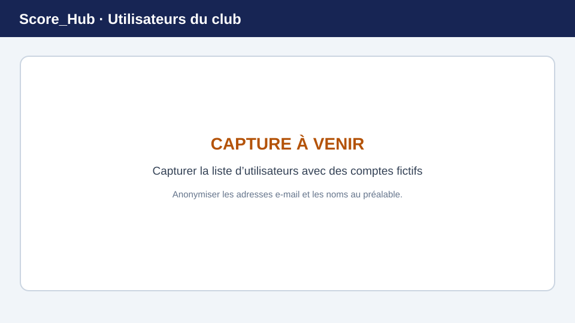

# Gérer les utilisateurs du club

La page **Utilisateurs** affiche les rattachements d’utilisateurs au club actuellement sélectionné. Elle est destinée à être modifiée par les administrateurs système et les administrateurs du club.

> **Image de remplacement :** remplacez cette illustration par une capture d’écran récente. Consultez [Remplacer les captures d’écran](../screenshots.md) pour plus de détails.

## Rattacher un utilisateur existant

1. Dans la section du club, ouvrez **Utilisateurs**.
2. Sélectionnez l’action permettant d’ajouter un utilisateur.
3. Recherchez un compte Score_Hub existant.
4. Sélectionnez le compte approprié et ajoutez-le au club.

Cette opération rattache un compte utilisateur existant ; l’interface ne sert ni à importer des listes de membres en masse ni à envoyer des invitations par e-mail.

## Modifier le rôle dans le club

1. Recherchez la personne dans la liste des utilisateurs du club.
2. Ouvrez la modification de son rôle dans le club.
3. Choisissez le rôle approprié et enregistrez la modification.

L’interface propose des rôles du club tels que l’administration du club, la gestion des concours et la saisie des résultats. N’attribuez que les autorisations nécessaires à la tâche.

## Utilisateur introuvable ?

Vérifiez l’orthographe du terme recherché. Le rattachement exige qu’un compte utilisateur Score_Hub existe déjà. Pour créer un compte ou si aucune action de modification n’est visible, contactez l’administration système ou celle du club.

Suite : [Rôles et autorisations](../getting-started/roles.md) · [Données du club](setup-club.md)
