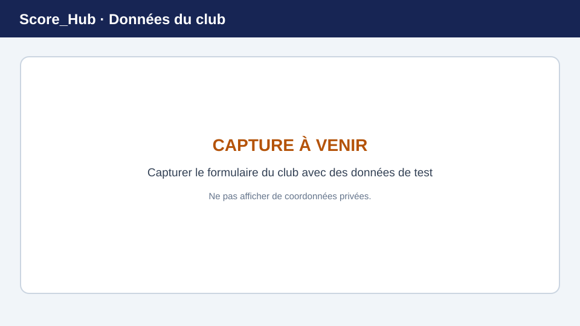

# Gérer les données du club

Dans la section du club, les utilisateurs autorisés peuvent modifier les données de base du club auquel ils sont actuellement rattachés. Tous les comptes ne peuvent pas créer eux-mêmes un nouveau club. Si votre club est absent ou ne vous est pas attribué, contactez l’administration système.

> **Image de remplacement :** remplacez cette illustration par une capture d’écran récente. Consultez [Remplacer les captures d’écran](../screenshots.md) pour plus de détails.

## Ouvrir et modifier les données de base

1. Connectez-vous et ouvrez la section du club dans la navigation.
2. Choisissez **Général** ou les données de base du club.
3. Vérifiez les informations existantes. Selon le modèle de données, elles comprennent le nom du club, son nom abrégé, son adresse, le code postal, la localité, le canton et son logo.
4. Sélectionnez **Modifier les informations**, effectuez les changements et enregistrez-les.
5. Après l’enregistrement, vérifiez les données affichées.

La possibilité de modifier ces informations dépend de votre statut d’administrateur système ou d’administrateur du club.

## Autres sections du club

- Dans **Utilisateurs**, les personnes autorisées gèrent le rattachement au club et le rôle des utilisateurs Score_Hub.
- Dans **Sites**, vous gérez les sites rattachés au club.
- Dans **Concours**, vous créez et gérez les concours du club.

Ces sections permettent de saisir uniquement les champs disponibles dans l’application. Les cotisations, les newsletters, les réservations et les imports groupés de fichiers ne font pas partie de ce guide.

Suite : [Utilisateurs du club](manage-members.md) · [Sites](manage-locations.md) · [Concours](../competitions/create-competition.md)
