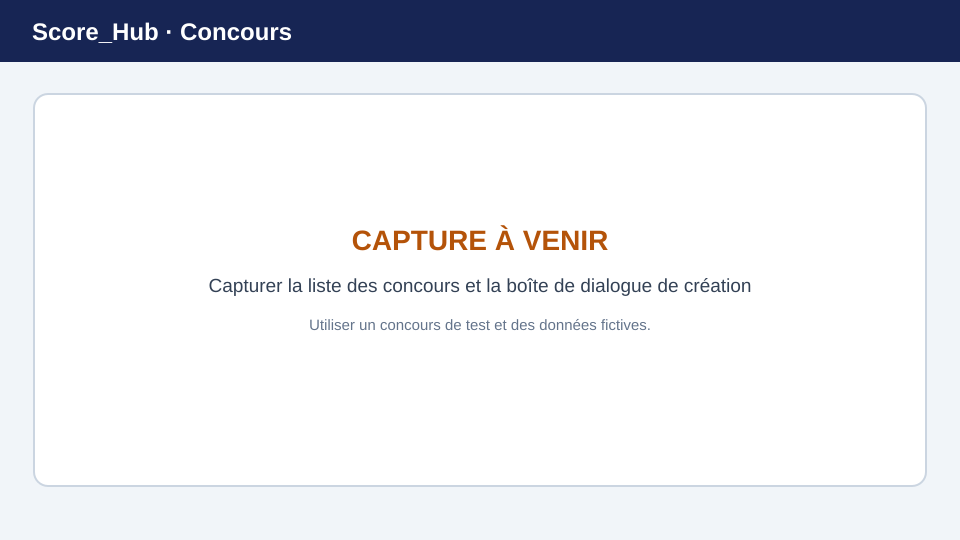

# Créer un concours

Les concours sont gérés dans la section du club. Vous devez disposer de l’autorisation correspondante du club ou du système pour en créer ou en modifier un.

> **Image de remplacement :** remplacez cette illustration par une capture d’écran récente. Consultez [Remplacer les captures d’écran](../screenshots.md) pour plus de détails.

## Créer un concours

1. Ouvrez **Club → Concours**.
2. Sélectionnez l’action permettant de créer un concours.
3. Renseignez les données de base affichées. Il s’agit notamment du nom, du nom abrégé, de la description, du type, du statut, de la discipline et des dates de début et de fin.
4. Vous pouvez éventuellement sélectionner un concours existant du même club comme modèle. Choisissez ensuite individuellement les catégories, les manches, le programme de tir, la matrice des distinctions, les prix et les règles de munitions, ainsi que les classements à reprendre. La matrice des distinctions et les règles de prix ne sont sélectionnables que si les catégories et les manches sont également reprises.
5. Enregistrez le concours. Il apparaît ensuite dans la liste du club. Les configurations reprises sont associées au nouveau concours ; vous devez saisir vous-même les données de base telles que le nom, la discipline et la période du nouveau concours.
6. Ouvrez la configuration du concours afin de vérifier les catégories, les champs de résultat, les distinctions, le décompte, les manches, les classements et les utilisateurs du concours, puis de les ajuster si nécessaire.

Les champs obligatoires sont indiqués dans le formulaire. Ne publiez pas le concours et ne modifiez pas son statut tant que sa configuration n’est pas adaptée à votre déroulement.

## Types de concours

L’application propose des concours individuels, par équipes et mixtes. Les classements et les groupes associés dépendent du type choisi et de la configuration.

## Après la création

- Complétez d’abord la configuration, notamment les manches, les catégories et les champs de résultat.
- Ajoutez les participants dans la section **Tireurs**.
- Pour les concours par équipes, créez les groupes nécessaires et affectez-y les participants.
- Attribuez les rôles du concours uniquement aux personnes qui ont besoin de l’accès correspondant.

Suite : [Configurer un concours](competition-settings.md) · [Gérer les participants](manage-participants.md) · [Saisir les résultats](../results/quick-start.md)
