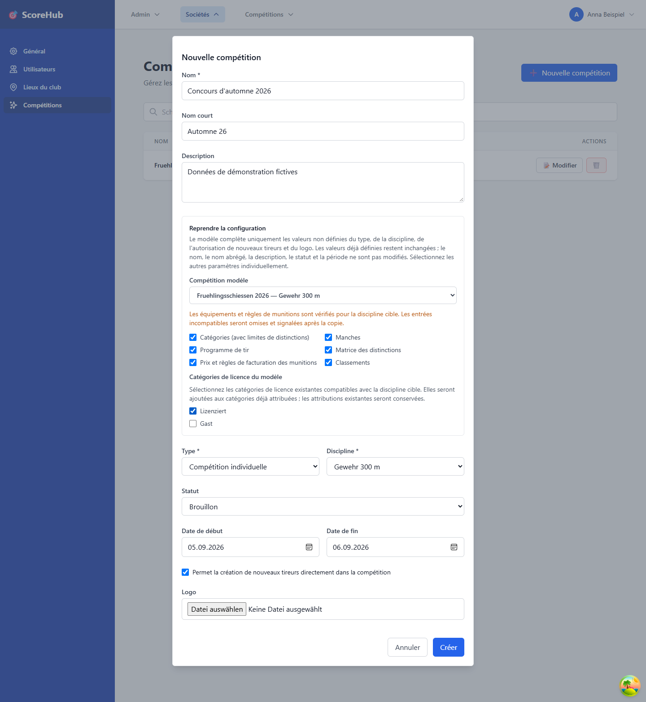

# Créer un concours

Les concours sont gérés dans la section du club. Vous devez disposer de l’autorisation correspondante du club ou du système pour en créer ou en modifier un.

## Créer un concours

1. Ouvrez **Club → Concours**.
2. Sélectionnez l’action permettant de créer un concours.
3. Renseignez les données de base affichées. Il s’agit notamment du nom, du nom abrégé, de la description, du type, du statut, de la discipline et des dates de début et de fin.
4. **Reprendre la configuration** se trouve juste après **Description**. Sélectionnez éventuellement un concours du même club comme modèle ; la liste affiche son nom et sa discipline. Le modèle complète les valeurs non définies du type, de la discipline, de l'autorisation de nouveaux tireurs et du logo. Vérifiez ces valeurs puis sélectionnez les autres options individuellement.
5. Enregistrez après le chargement du modèle et des catégories de licence. Le concours apparaît dans la liste du club. Le nom, le nom abrégé, la description, le statut et les dates restent vos propres données ; ils ne sont pas repris du modèle.
6. Ouvrez la configuration du concours afin de vérifier les catégories, les champs de résultat, les distinctions, le décompte, les manches, les classements et les utilisateurs du concours, puis de les ajuster si nécessaire.

Les champs obligatoires sont indiqués dans le formulaire. Ne publiez pas le concours et ne modifiez pas son statut tant que sa configuration n’est pas adaptée à votre déroulement.

## Que peut-on reprendre d'un modèle ?

Les données générales déjà définies ne sont **pas écrasées**. Le type affiché par défaut et la case de nouveaux tireurs non encore modifiée sont considérés comme non définis. Un choix explicite est conservé, même si l'autorisation de nouveaux tireurs est désactivée. En changeant de modèle, les valeurs déjà complétées restent également inchangées. Vous pouvez choisir une autre discipline ; la sélection des catégories de licence est alors rechargée et réinitialisée.

| Option | Conditions et contenu |
| --- | --- |
| Catégories (avec limites de distinctions) | Discipline cible choisie. Copie les catégories, équipements compatibles, exclusions de catégories d'âge et limites. Les distinctions nécessaires aux limites sont créées et leurs références réattribuées. |
| Manches | Discipline cible choisie. Copie les noms, numéros et restrictions de participation. Sans classements copiés, les restrictions liées aux classements sont réinitialisées à **tous**. |
| Programme de tir | Uniquement avec les manches. Reprend le nombre de coups par manche. |
| Matrice des distinctions | Uniquement avec catégories et manches. Reprend les distinctions et seuils des catégories, manches et équipements compatibles copiés. |
| Prix et règles de munitions | Uniquement avec catégories et manches. Reprend les prix compatibles, les règles générales et les règles de munitions pour les calibres disponibles. |
| Classements | Reprend définitions, champs de résultat supplémentaires, tri et colonnes. Les indices des champs sont conservés. Les liens vers les manches ne sont créés que si les manches sont copiées. |
| Catégories de licence du modèle | Seules les catégories existantes attribuées à la discipline cible sont proposées individuellement. Les catégories cochées sont **ajoutées** ; les attributions existantes restent inchangées et ne sont pas dupliquées. Sans sélection, les catégories automatiquement attribuées depuis la discipline cible sont conservées. |

## Disciplines différentes : quelles lacunes ?

La discipline du modèle n'est pas imposée. Si votre discipline cible diffère :

- **Équipements :** seuls les équipements attribués à la discipline cible ou sans aucune attribution de discipline sont repris. Ceux exclusivement attribués à d'autres disciplines sont omis.
- **Catégories :** si une catégorie a des équipements explicitement attribués et qu'aucun n'est compatible, toute la catégorie est omise, ainsi que ses règles de matrice et de prix. Une catégorie sans équipements attribués est conservée.
- **Matrice :** les entrées liées aux équipements incompatibles sont omises. Les entrées sans équipement sont conservées si leur catégorie est copiée. Les seuils ne sont pas convertis sur le plan sportif.
- **Munitions :** les règles de calibres sans équipement disponible sont omises. Les règles de prix générales et celles des catégories/manches conservées restent présentes.
- **Licences :** les catégories non attribuées à la discipline cible ne sont pas sélectionnables ; leur nombre est affiché. La compatibilité est revérifiée à l'enregistrement. Si les attributions ont changé, les catégories sélectionnées devenues incompatibles sont omises et signalées.
- **Manches, programme et classements :** leur structure peut être copiée. Vérifiez vous-même les nombres de coups, champs de résultat, seuils et types de classement pour la nouvelle discipline et le type du concours.

Exemple : la catégorie **A** du modèle utilise uniquement un équipement attribué au fusil 300 m. Pour une autre discipline, **A** est omise si aucun équipement attribué n'est compatible. Ses prix et entrées de matrice manquent également ; une règle générale sans catégorie reste présente.

## Vérifications et erreurs de copie

Avant l'enregistrement, l'interface explique les différences de discipline et les dépendances manquantes. Après une reprise partielle, elle indique le nombre de catégories, équipements, entrées de matrice, règles de prix/munitions, liens classements-manches et catégories de licence omis, ainsi que les restrictions de participation réinitialisées.

Le modèle ne copie **ni participants, ni affectations de groupes, ni résultats, ni stocks/écritures de feuilles de stand, ni utilisateurs et rôles du concours**. Configurez-les séparément. Le nom et l'identifiant du nouveau concours sont indépendants du modèle.

Une erreur de chargement bloque l'enregistrement avec ce modèle. Sélectionnez-le à nouveau ou choisissez **Ne pas utiliser de modèle**. Les données générales déjà complétées restent dans le formulaire ; vérifiez-les avant d'enregistrer.

La création et la copie ne sont pas atomiques. Si la copie échoue après la création, le nouveau concours reste présent et peut être incomplet. Ouvrez-le pour vérifier et compléter ses paramètres au lieu de le créer une deuxième fois.

## Types de concours

L’application propose des concours individuels, par équipes et mixtes. Les classements et les groupes associés dépendent du type choisi et de la configuration.

## Après la création

- Complétez d’abord la configuration, notamment les manches, les catégories et les champs de résultat.
- Ajoutez les participants dans la section **Tireurs**.
- Pour les concours par équipes, créez les groupes nécessaires et affectez-y les participants.
- Attribuez les rôles du concours uniquement aux personnes qui ont besoin de l’accès correspondant.

Suite : [Configurer un concours](competition-settings.md) · [Gérer les participants](manage-participants.md) · [Saisir les résultats](../results/quick-start.md)
