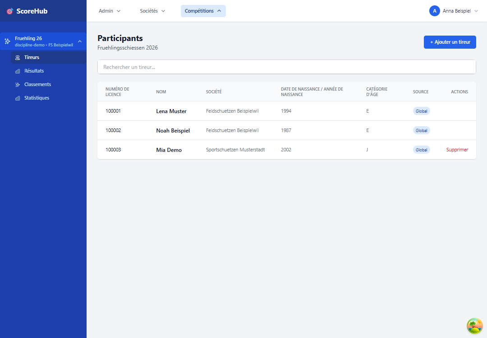
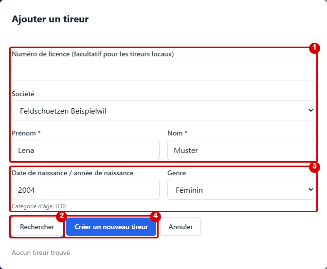
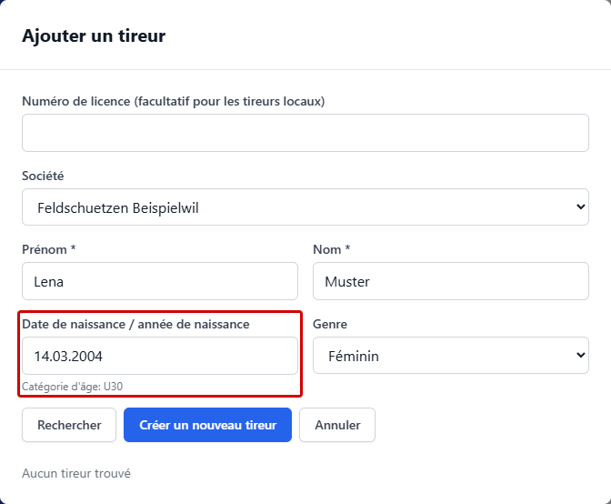

# Tireurs, participants et groupes

Les participants d’un concours sont gérés dans la section **Tireurs**. Les groupes et leur composition se gèrent séparément dans la section **Groupes**.

## Ajouter des tireurs

1. Ouvrez le concours et accédez à **Tireurs**.
2. Choisissez **Ajouter un tireur** et recherchez un tireur existant dans la boîte de dialogue.
3. Sélectionnez l’entrée appropriée dans les résultats et ajoutez-la au concours. Vérifiez ensuite la liste des participants.

### Créer un nouveau tireur

Si aucun tireur ne convient, vous pouvez le créer directement dans la boîte de dialogue lorsque la création est autorisée pour le concours. L’accès dépend de votre rôle. Les illustrations présentent des données fictives ; les repères rouges ont été ajoutés pour ce guide.

1. Saisissez le prénom et le nom et choisissez la société si nécessaire. Le numéro de licence est facultatif pour les tireurs locaux.
2. Choisissez **Rechercher** pour vérifier les entrées existantes. Si un résultat convient, sélectionnez-le au lieu de créer un doublon.
3. Si aucun résultat ne convient, complétez l’année ou la date de naissance ainsi que le genre si nécessaire. La catégorie d’âge affichée est déterminée à partir de l’année de naissance.
4. Choisissez **Créer un nouveau tireur**. Vérifiez ensuite l’entrée dans la liste des participants.

### Date ou année de naissance

Le champ **Date de naissance / année de naissance** accepte les deux formats :

- L’année à quatre chiffres uniquement, par exemple `2004` : lors de l’enregistrement, la date de naissance devient automatiquement **01.01.2004**.
- La date complète, par exemple `14.03.2004` : cette date est conservée à l’enregistrement. Le format `2004-03-14` est également accepté.

Seule l’année de naissance est actuellement nécessaire pour la catégorie d’âge. Le champ peut rester vide ; dans ce cas, aucune catégorie d’âge n’est proposée à partir de la date de naissance. La boîte de dialogue signale les dates non valides et les années hors de l’intervalle entre 1900 et l’année actuelle.

L’importation de listes de participants au format Excel ou CSV ne fait pas partie de cette procédure.

## Modifier ou supprimer les données d’un tireur

Sélectionnez le tireur dans la liste et utilisez l’action de modification proposée. Les modifications ou la suppression peuvent être limitées si des résultats ont déjà été saisis. Modifiez soigneusement les données de base, car elles peuvent être utilisées dans les résultats et les classements.

## Former des groupes

1. Accédez à **Groupes**.
2. Si nécessaire, sélectionnez la catégorie et la manche.
3. Créez un groupe avec un nom unique.
4. Ajoutez au groupe les tireurs du concours concernés.
5. Vérifiez l’affectation pour chaque manche et catégorie pertinente.

Selon la configuration du concours, la composition des groupes peut être gérée séparément pour chaque manche et catégorie. Vérifiez les affectations avant la saisie des résultats.

Suite : [Configurer un concours](competition-settings.md) · [Saisir les résultats](../results/quick-start.md)
