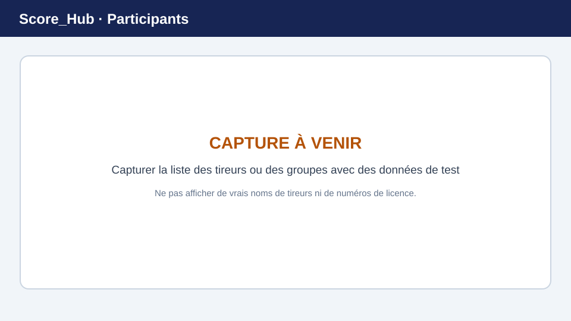

# Tireurs, participants et groupes

Les participants d’un concours sont gérés dans la section **Tireurs**. Les groupes et leur composition se gèrent séparément dans la section **Groupes**.

> **Image de remplacement :** remplacez cette illustration par une capture d’écran récente. Consultez [Remplacer les captures d’écran](../screenshots.md) pour plus de détails.

## Ajouter des tireurs

1. Ouvrez le concours et accédez à **Tireurs**.
2. Recherchez un tireur existant.
3. Sélectionnez l’entrée appropriée et ajoutez-la au concours.
4. Si la fonctionnalité est activée, vous pouvez créer un nouveau tireur directement dans la boîte de dialogue d’ajout. Le formulaire peut contenir des informations telles que le nom, le numéro de licence, la date de naissance, le club et le sexe.
5. Vérifiez que le tireur apparaît dans la liste des participants.

L’importation de listes de participants au format Excel ou CSV ne fait pas partie de cette procédure.

## Modifier ou supprimer les données d’un tireur

Sélectionnez le tireur dans la liste et utilisez l’action de modification proposée. Les modifications ou la suppression peuvent être limitées si des résultats ont déjà été saisis. Modifiez soigneusement les données de base, car elles peuvent être utilisées dans les résultats et les classements.

## Former des groupes

1. Accédez à **Groupes**.
2. Si nécessaire, sélectionnez la catégorie et la manche.
3. Créez un groupe avec un nom unique.
4. Ajoutez au groupe les tireurs du concours concernés.
5. Vérifiez l’affectation pour chaque manche et catégorie pertinente.

Selon la configuration du concours, la composition des groupes peut être gérée séparément pour chaque manche et catégorie. Vérifiez les affectations avant la saisie des résultats.

Suite : [Configurer un concours](competition-settings.md) · [Saisir les résultats](../results/quick-start.md)
