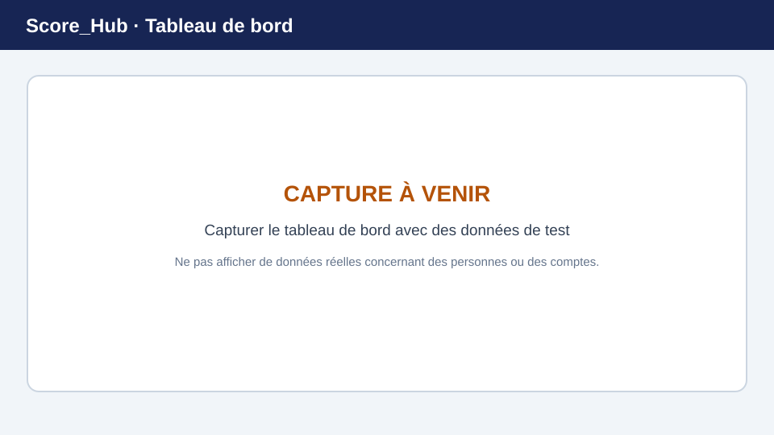

# Tableau de bord et navigation

Le tableau de bord est la page d’accueil après la connexion. Il affiche des indicateurs, des actions rapides et les concours disponibles pour votre compte.

> **Image de remplacement :** remplacez cette illustration par une capture d’écran récente. Consultez [Remplacer les captures d’écran](../screenshots.md) pour plus de détails.

## Sections du tableau de bord

- **Concours actifs :** liste des concours disponibles pour vous, avec leur statut et, le cas échéant, le nom du club.
- **Actions rapides :** les actions affichées dépendent de votre rôle. Les administrateurs voient des liens de gestion supplémentaires.
- **Indicateurs :** les totaux affichés sont des récapitulatifs du système. L’indicateur des résultats n’est actuellement pas connecté et peut donc afficher `0` ; il ne représente pas un décompte complet des résultats.

Pour un concours, utilisez les actions proposées afin d’ouvrir la section des résultats ou le classement. Pour configurer un concours, accédez à la section du club et ouvrez **Concours**.

## Navigation

La barre latérale regroupe les sections disponibles. Selon vos autorisations, vous pouvez notamment voir :

- **Club :** données de base, utilisateurs du club, sites et concours
- **Concours :** participants, groupes, résultats, classements et statistiques du concours ouvert
- **Administration :** gestion des utilisateurs, des clubs et des données de base à l’échelle du système ; réservée aux administrateurs système
- **Profil et langue :** informations personnelles et choix de la langue

Sur les petits écrans, la barre latérale peut être réduite. Utilisez le bouton de navigation pour l’ouvrir.

Suite : [Rôles](roles.md) · [Créer un concours](../competitions/create-competition.md)
