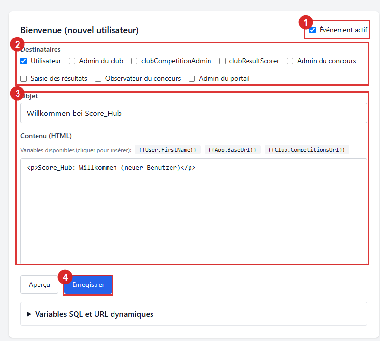
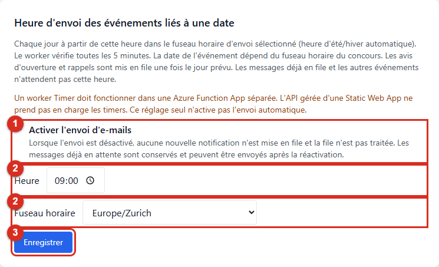
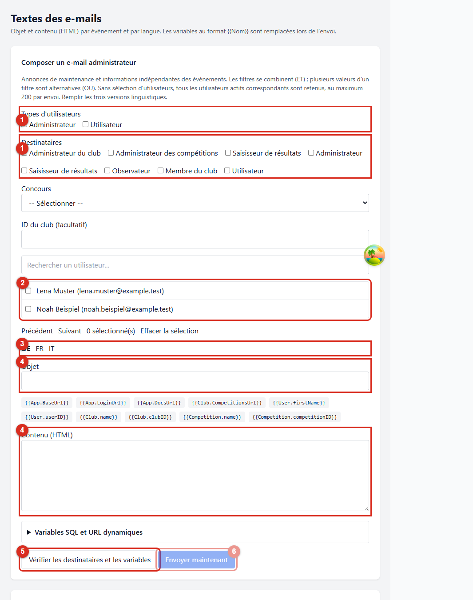

# Notifications et e-mails administrateur

Score_Hub envoie des e-mails automatiques lors de certains événements liés aux comptes et aux concours. L’administration système peut configurer les événements, les rôles destinataires et les textes. Une boîte de dialogue distincte permet également d’envoyer des communications manuelles.

*1 active ou désactive l’événement, 2 définit les rôles destinataires, 3 repère l’objet et le contenu HTML, et 4 enregistre le modèle.*

## Événements, déclencheurs et destinataires

Le tableau indique les événements et les rôles destinataires activés par défaut. Les rôles se configurent pour chaque événement dans **Textes des e-mails**. Les destinataires doivent être des utilisateurs actifs ayant le rôle sélectionné dans le club ou le concours concerné.

| Événement | Déclenchement | Destinataires par défaut |
| --- | --- | --- |
| Bienvenue | Lors de l’inscription ou de la création d’un compte utilisateur | Le nouvel utilisateur |
| Club : utilisateur ajouté | Lorsqu’un utilisateur est associé à un club | L’utilisateur ajouté |
| Club : rôle supprimé | Lorsqu’une attribution de rôle de club est supprimée | L’utilisateur concerné |
| Concours : utilisateur ajouté | Lorsqu’un utilisateur est associé à un concours | L’utilisateur ajouté |
| Concours : rôle modifié | Lorsque le rôle du créateur passe à celui d’administrateur du concours lors de la reprise des utilisateurs depuis un modèle | L’utilisateur concerné |
| Ouverture de la saisie des résultats | À la **date de début de saisie** du concours, si l’avis d’ouverture est activé dans le concours | Administration système, administration du club organisateur, administration du concours, personnes chargées de saisir les résultats et personnes autorisées à consulter le concours |
| Fin prochaine de la période de saisie | Sept jours avant la **date limite de saisie** du concours, si le rappel est activé dans le concours | Administration système, administration du club organisateur et administration du concours |

Les deux dernières dates correspondent à la **date de début de saisie** et à la **date limite de saisie**, et non aux dates de début et de fin du concours. Chaque avis doit être activé à deux endroits : l’événement dans **Textes des e-mails** et l’option correspondante dans l’onglet **Général** de la configuration du concours. Le rappel de fin ne s’applique que si une date limite est définie.

Les notifications d’attribution de compte ou de rôle sont adressées au compte concerné. Pour ces notifications personnelles, les règles de destinataire déterminent si elles sont activées pour l’utilisateur. Les règles de destinataires des rappels de saisie se configurent indépendamment.

## Configurer les événements automatiques

1. Connectez-vous en tant qu’administrateur système et ouvrez **Administration → Textes des e-mails**.
2. Dépliez l’événement en cliquant sur son titre. **Événement activé** active ou désactive cet événement pour tout le système.
3. Sous **Destinataires**, sélectionnez les rôles auxquels envoyer le message.
4. Choisissez **de**, **fr** et **it**, puis renseignez l’objet et le contenu HTML pour chaque langue. Le modèle utilisé dépend de la langue préférée du destinataire.
5. Utilisez les boutons de variables pour insérer des valeurs telles que `{{User.FirstName}}` ou `{{Competition.Name}}` à la position du curseur.
6. Contrôlez le modèle avec **Aperçu**, puis enregistrez les modifications de l’événement.

Un événement désactivé ne met aucun nouveau message en file. Les modifications de modèle concernent les futurs messages ; les messages déjà préparés pour l’envoi conservent leur contenu rendu.

### Heure d’envoi des événements liés à une date

Le réglage **Heure d’envoi des événements liés à une date** définit une heure et un fuseau d’envoi communs au système. La valeur par défaut est **09:00 / Europe/Zurich**. Le Timer vérifie toutes les cinq minutes et met en file les avis d’ouverture et de fin à partir de l’heure choisie, le jour de l’événement. Le jour de l’événement dépend du fuseau du concours ; l’heure dépend du fuseau d’envoi sélectionné ici. Modifier l’heure ou le fuseau ne renvoie pas les événements déjà mis en file.

*1 met en pause ou active tous les envois d’e-mails, 2 définit l’heure et le fuseau, et 3 enregistre les réglages.*

Les messages de bienvenue et d’attribution ainsi que les e-mails administrateur manuels ne dépendent pas de cette heure quotidienne. La file d’attente ou le fournisseur peut retarder la livraison effective.

**Condition d’exploitation :** le Timer doit fonctionner dans une Azure Function App séparée. L’API gérée d’Azure Static Web Apps ne prend pas en charge les timers. Le réglage de l’heure ne déploie pas le worker.

### Vue des envois et vérification du worker

La **Vue d’ensemble des envois** indique les envois acceptés, en attente, en traitement, en nouvelle tentative, en échec et suspendus pour vérification. Cliquez sur un compteur pour afficher les 100 derniers envois correspondants. **Envoyé** signifie accepté par le fournisseur, pas reçu dans la boîte mail.

La vue vérifie chaque minute le signal de vie du worker. Un signal expiré, une exécution échouée ou une mauvaise configuration détectée apparaît comme erreur. Si le signal ou les droits de lecture manquent, elle indique explicitement que le worker ne peut pas être vérifié. **Synchronisé** ne prouve pas que le worker fonctionne actuellement.

### État de synchronisation après une modification

Après l’enregistrement, cette section affiche l’état de synchronisation avec le worker de notifications. **Synchronisé** signifie que la révision enregistrée a été appliquée. Si l’état est **En attente** ou **Erreur**, la modification est enregistrée, mais pas encore effective.

**Actualiser l’état de synchronisation** recharge manuellement cet état sans remplacer les champs non enregistrés ; aucune actualisation automatique n’est effectuée. Si la synchronisation est en attente ou a échoué, **Réparer la synchronisation** republie la configuration enregistrée, puis recharge l’état. Les champs non enregistrés ne sont pas sauvegardés par cette action. Une publication réussie ne confirme ni l’application effective des réglages ni la livraison d’un e-mail.

Une nouvelle heure d’envoi ne s’applique qu’après une synchronisation réussie. Les messages déjà mis en file ne sont pas créés à nouveau. L’heure correspond au début prévu du traitement, et non à une minute de livraison garantie. Les e-mails administrateur manuels et les messages personnels de bienvenue ou d’attribution ne dépendent pas de cette heure quotidienne.

### Mettre globalement l’envoi en pause

La case **Activer l’envoi d’e-mails**, dans le réglage de l’heure d’envoi, active ou désactive globalement les e-mails. Lorsque l’envoi est désactivé, aucun nouvel e-mail n’est mis en file et les e-mails en attente ne sont pas traités. Les e-mails déjà mis en file sont conservés et peuvent être traités après réactivation. L’aperçu et la vérification des destinataires des e-mails administrateur restent disponibles.

### Notifications du tableau de bord, conservation et mode e-mail

**Activer les notifications du tableau de bord** active la boîte de réception du tableau de bord comme canal supplémentaire. Les communications administrateur peuvent ainsi être disponibles dans le tableau de bord même lorsque l’envoi d’e-mails est désactivé. Si les e-mails et les notifications du tableau de bord sont tous deux désactivés, l’envoi est bloqué.

Le tableau de bord affiche chaque message sous forme d’une ligne d’objet compacte. **Ouvrir** ou un double-clic affiche le contenu HTML dans une boîte de dialogue et marque le message comme lu. Une erreur est signalée sans modifier prématurément l’état de lecture.

**Conserver les notifications lues (jours)** définit une durée de **1 à 365 jours** ; la valeur par défaut est de 30 jours. Les notifications lues du tableau de bord sont supprimées après cette durée ; les notifications non lues sont conservées. Une réduction de la durée peut supprimer définitivement des notifications déjà lues lors du prochain nettoyage.

Le **Mode e-mail** détermine comment le contenu est marqué : **DEV** et **TEST** ajoutent une indication à l’objet et au contenu ; **PROD** envoie le modèle sans modification. Vérifiez le mode avant d’activer l’envoi en production.

## Variables des modèles

La liste compacte **Variables utilisées** affiche une ligne par variable des modèles linguistiques ou définition personnalisée créée explicitement. **Ajouter une variable** ouvre une boîte de dialogue pour rechercher les variables disponibles et les sélectionner avec **Insérer**. La variable est insérée à la position du curseur du dernier champ d’objet ou de contenu utilisé. **Copier** la place dans le presse-papiers. **Modifier** ouvre les détails d’une définition personnalisée sans changer son nom.

Dans cette même boîte de dialogue, **Configurer une variable personnalisée** permet de créer jusqu’à 50 valeurs supplémentaires par modèle. Aucune définition personnalisée n’est créée à l’avance. Le nom est généré automatiquement lors de la création :

- **Champ :** lit un champ d’une table proposée.
- **Nombre (COUNT) :** compte les enregistrements correspondants ; une sélection vide retourne `0`.
- **URL dynamique :** crée un lien à partir de la base de l’application ou de la documentation, d’un chemin relatif et éventuellement d’une ancre.

Chaque requête SQL nécessite au moins un filtre de contexte. Le contexte peut être l’ID utilisateur du destinataire, un ID de club ou un ID de concours ; jusqu’à trois filtres sont appliqués ensemble. Un champ doit correspondre à un seul enregistrement. Les champs sensibles ne sont pas proposés. Une URL dynamique utilise une base d’application ou de documentation et un chemin relatif, avec éventuellement une ancre. Vérifiez l’objet et le contenu avec les valeurs réelles de l’événement avant d’enregistrer le modèle.

## Envoyer un e-mail administrateur

*1 repère les types d’utilisateurs et les rôles, 2 la sélection individuelle, 3 le choix de la langue, 4 l’objet et le contenu, 5 la vérification des destinataires et variables, et 6 la mise en file. L’envoi reste bloqué sans aperçu valide.*

1. Dans **Administration → Textes des e-mails**, ouvrez la section **Envoyer directement aux utilisateurs**.
2. Sélectionnez au moins un public : utilisateurs précis, types d’utilisateurs du système, rôles de club ou de concours, et éventuellement un concours ou un ID de club.
3. Renseignez l’objet et le contenu en allemand, français et italien. Le modèle de la langue préférée de chaque destinataire sera utilisé.
4. Ajoutez les variables nécessaires et choisissez **Vérifier les destinataires et les variables**.
5. Vérifiez l’aperçu généré pour chaque destinataire. Une variable manquante, vide ou ambiguë bloque l’envoi.
6. Choisissez **Envoyer maintenant**. Les destinataires et le contenu rendu sont placés dans la file d’envoi.

Les différents filtres se combinent (ET) ; plusieurs valeurs d’un même filtre sont alternatives (OU). Si aucun utilisateur n’est sélectionné individuellement, tous les utilisateurs actifs correspondant aux autres filtres sélectionnés sont inclus. Un envoi est limité à 200 destinataires et nécessite au moins un filtre de public.

Les e-mails administrateur sont des communications manuelles, et non des événements automatiques. Leur aperçu et leur mise en file ne dépendent pas de l’heure quotidienne, mais l’envoi effectif nécessite que le commutateur global soit activé. Le message de confirmation indique la mise en file, pas la livraison.

## Préférences personnelles et fuseaux horaires

Les préférences individuelles par événement sont prises en compte lors de la sélection des destinataires. Toutefois, l’interface utilisateur ne propose actuellement aucune page de profil permettant de modifier ces préférences. L’administration système gère donc les rôles destinataires des événements automatiques.

Le fuseau horaire du profil détermine l’affichage des instants. Pour les notifications liées à une date, le jour du concours dans son fuseau horaire fait foi ; l’heure quotidienne d’envoi utilise le fuseau d’envoi distinct défini à l’échelle du système. Les dates limites de saisie sont inclusives et vérifiées selon le fuseau du concours. Les personnes chargées de saisir les résultats peuvent créer, modifier et supprimer des résultats pendant cette période. Une limite absente laisse la période ouverte ; les concours terminés ou annulés restent verrouillés.

Suite : [Rôles et autorisations](getting-started/roles.md) · [Configurer un concours](competitions/competition-settings.md)
