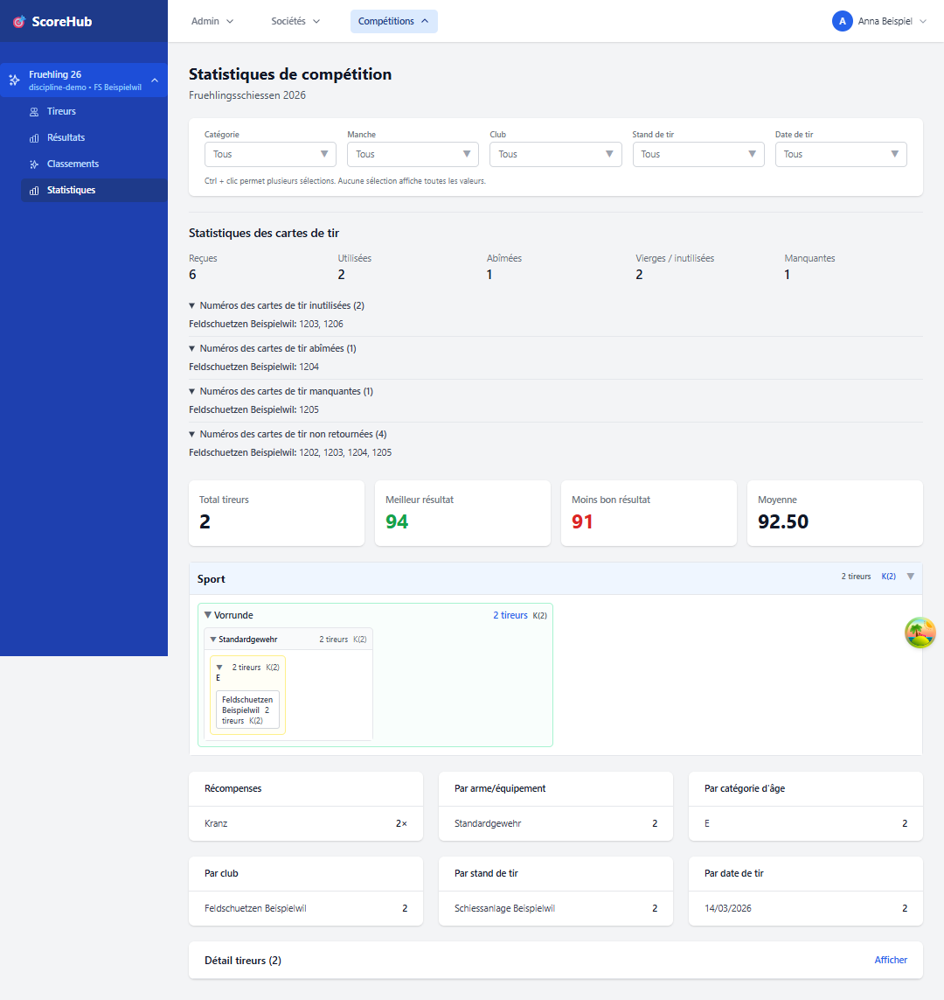

# Statistiques du concours

La page **Statistiques** récapitule les résultats du concours ouvert. Les analyses affichées dépendent des résultats disponibles et des filtres proposés.

## Consulter les statistiques

1. Ouvrez le concours et sélectionnez **Statistiques**.
2. Choisissez les filtres disponibles, par exemple la catégorie, le club, le site ou le jour de tir.
3. Examinez les indicateurs et les tableaux en tenant compte de la sélection effectuée.

Des sections vides ne signifient pas nécessairement que le concours ne comporte aucun résultat. Vérifiez d’abord les filtres et la catégorie. Les indicateurs ne sont valables que pour les données et le périmètre de sélection affichés dans l’application.

## Inventaire des feuilles de stand et retours

Lorsque le [suivi des feuilles de stand](../competitions/data-sheet-tracking.md) est activé, les statistiques affichent le nombre de feuilles reçues, consommées, mal remplies, retournées vierges et explicitement manquantes. Le filtre du club s’applique à ces quantités ; les personnes dont la saisie est limitée ne voient que leur club. Les numéros individuels figurent sur la page **Cartes de tir** du concours.

**Vierges / retournées** compte uniquement les feuilles retournées sans avoir été utilisées. Les feuilles retournées consommées ou mal remplies ne sont pas incluses. L’administration du concours ou du système enregistre le retour sur la page **Cartes de tir**.

Si l’option **Décompte au format PDF** est activée, le document reprend les quantités filtrées par club, y compris les cartes retournées vierges. Les listes de numéros ne sont pas imprimées.

Sans suivi des numéros, les écritures de quantités n’indiquent pas le statut des feuilles. Le PDF affiche donc la quantité retournée sous **Cartes retournées (sans statut)**.

## Sortie PDF

Si la page propose une action PDF, vérifiez la sélection et les filtres avant de créer le fichier. Pour d’autres analyses, utilisez les résultats sous-jacents ou contactez l’administration du concours.

## Lot de PDF dans un ZIP

Lorsque la sortie de décompte PDF est activée, **Lot PDF (ZIP)** apparaît à côté. Par défaut, le dialogue crée un décompte par club, réunissant toutes les catégories sélectionnées. Les clubs disposant de feuilles de stand reçoivent aussi un document sans résultats correspondants.

1. Définissez les filtres sur la page des statistiques.
2. Ouvrez **Lot PDF (ZIP)** et choisissez club, catégorie, tour, stand ou date de tir. Plusieurs critères sélectionnés sont combinés.
3. Activez si nécessaire le **PDF global** : il ajoute un décompte sans ces regroupements, en conservant les filtres actuels.
4. Téléchargez le ZIP contenant les PDF individuels.

Les documents uniquement par club et le document global incluent les quantités et coûts de feuilles de stand correspondants. Un regroupement par catégorie, tour, stand ou date produit une **analyse statistique, pas un décompte** : aucun montant n’est imprimé et les quantités de feuilles non attribuables sont indiquées à **0**. La consommation et les quantités de munitions déduites des résultats restent visibles. Les clubs sans résultats correspondants reçoivent un document supplémentaire par club plutôt qu’une subdivision inventée.

Seuls les critères comportant au moins deux valeurs visibles sont sélectionnables. Les personnes limitées à leur propre club n’exportent que celui-ci ; **Club** reste grisé. Cette restriction s’applique aussi aux feuilles de stand et au PDF global.

Suite : [Consulter les classements](view-rankings.md)
