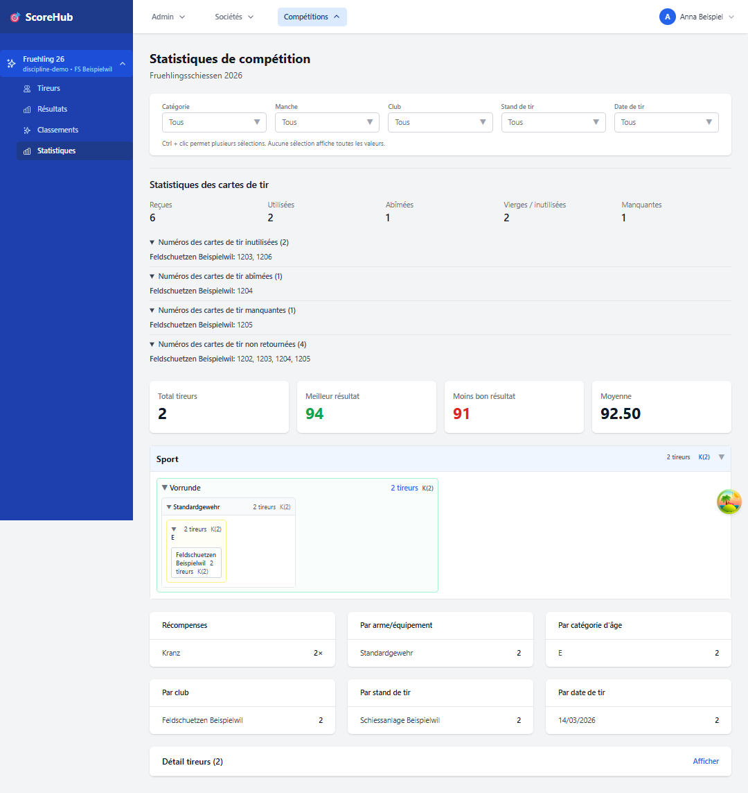

# Statistiques du concours

La page **Statistiques** récapitule les résultats du concours ouvert. Les analyses affichées dépendent des résultats disponibles et des filtres proposés.

## Consulter les statistiques

1. Ouvrez le concours et sélectionnez **Statistiques**.
2. Choisissez les filtres disponibles, par exemple la catégorie, le club, le site ou le jour de tir.
3. Examinez les indicateurs et les tableaux en tenant compte de la sélection effectuée.

Des sections vides ne signifient pas nécessairement que le concours ne comporte aucun résultat. Vérifiez d’abord les filtres et la catégorie. Les indicateurs ne sont valables que pour les données et le périmètre de sélection affichés dans l’application.

## Inventaire des feuilles de stand et retours

Lorsque le [suivi des feuilles de stand](../competitions/data-sheet-tracking.md) est activé, les statistiques affichent le nombre de feuilles reçues, consommées, mal remplies, vierges et explicitement manquantes. Des listes déroulantes indiquent les numéros inutilisés, mal remplis, manquants et pas encore retournés. Le filtre du club s’applique également à ces quantités et listes ; les personnes dont la saisie est limitée ne voient que leur club.

La consommation et le retour sont indépendants : une feuille associée à un résultat peut ne pas avoir encore été retournée. Une feuille vierge retournée reste comptée comme vierge, mais n’est plus considérée comme un retour en attente. L’administration du concours enregistre le retour effectif dans **Configuration → Décompte** en indiquant les numéros concernés.

Si l’option **Décompte au format PDF** est activée, le document reprend les quantités de feuilles de stand filtrées par club, y compris les feuilles mal remplies, vierges et les retours en attente. Les listes de numéros ne sont pas imprimées.

## Sortie PDF

Si la page propose une action PDF, vérifiez la sélection et les filtres avant de créer le fichier. Pour d’autres analyses, utilisez les résultats sous-jacents ou contactez l’administration du concours.

Suite : [Consulter les classements](view-rankings.md)
