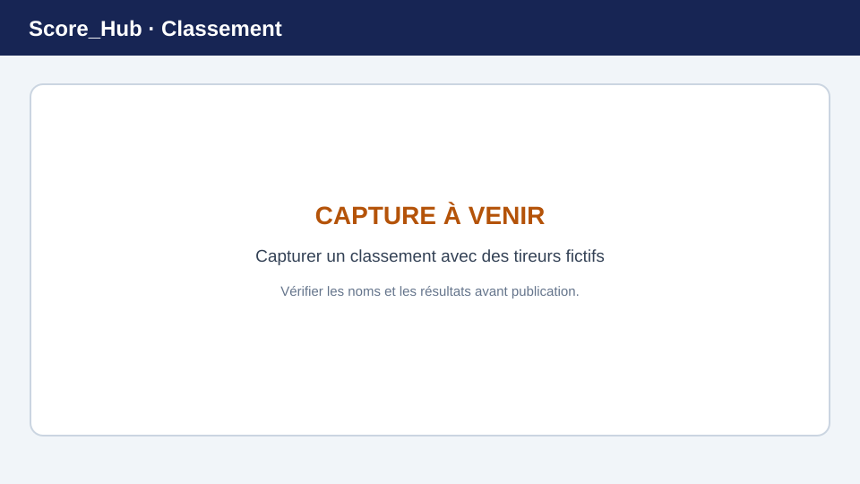

# Consulter les classements

Les classements d’un concours se trouvent dans la section **Classements**. Les types de classement affichés dépendent des classements, des catégories et des résultats configurés pour le concours.

> **Image de remplacement :** remplacez cette illustration par une capture d’écran récente. Consultez [Remplacer les captures d’écran](../screenshots.md) pour plus de détails.

## Sélectionner et filtrer un classement

1. Ouvrez le concours et sélectionnez **Classements**.
2. Choisissez la catégorie et, si cette option est disponible, le classement.
3. Utilisez les filtres proposés, par exemple le club, le site ou le jour de tir.
4. Vérifiez les résultats et le classement affiché.

Un classement peut être vide si aucun résultat correspondant n’a encore été saisi ou si les filtres ne renvoient aucune entrée. Effacez les filtres et vérifiez que l’administration du concours a configuré le classement.

## Enregistrer un classement au format PDF

Si votre rôle le permet, utilisez l’action PDF du classement. Avant l’exportation, vérifiez la catégorie sélectionnée et les filtres. Ce guide ne considère pas les autres formats d’export, tels qu’Excel ou CSV, comme disponibles.

## Détails des résultats

Si une vue détaillée du classement est proposée, ouvrez-la pour consulter les résultats correspondants. Les classements reflètent l’état des données enregistrées et la configuration. En cas d’écart, vérifiez d’abord les résultats, la catégorie et les filtres.

Suite : [Statistiques](statistics.md) · [Corriger les résultats](../results/editing-results.md)
