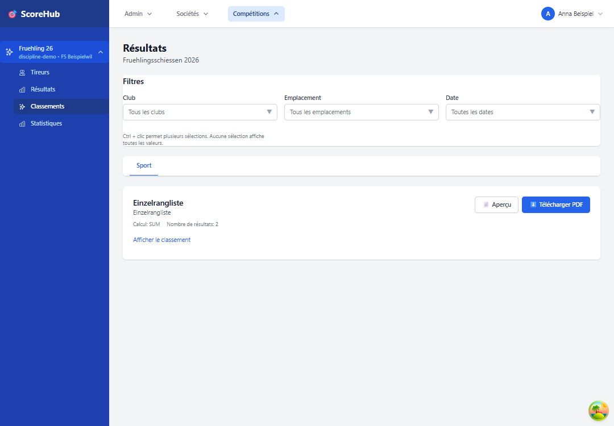

# Consulter les classements

Les classements d’un concours se trouvent dans la section **Classements**. Les types de classement affichés dépendent des classements, des catégories et des résultats configurés pour le concours.

## Sélectionner et filtrer un classement

1. Ouvrez le concours et sélectionnez **Classements**.
2. Choisissez la catégorie et, si cette option est disponible, le classement.
3. Utilisez les filtres proposés, par exemple le club, le site ou le jour de tir.
4. Vérifiez les résultats et le classement affiché.

Un classement peut être vide si aucun résultat correspondant n’a encore été saisi ou si les filtres ne renvoient aucune entrée. Effacez les filtres et vérifiez que l’administration du concours a configuré le classement.

## Enregistrer un classement au format PDF

Si votre rôle le permet, utilisez l’action PDF du classement. Avant l’exportation, vérifiez la catégorie sélectionnée et les filtres. Ce guide ne considère pas les autres formats d’export, tels qu’Excel ou CSV, comme disponibles.

## Enregistrer plusieurs classements en ZIP

Pour un export direct, cliquez sur **PDF de toutes les catégories** pour le classement souhaité. Sans autre dialogue, un ZIP contenant exactement un PDF par catégorie avec des résultats est téléchargé. Les filtres de club, de stand et de date ainsi que les restrictions au propre club sont conservés ; l'onglet de catégorie actif ne limite pas cet export. Les catégories vides sont ignorées. La progression est affichée pendant la création.

Pour une répartition supplémentaire par club, stand ou date, utilisez l'export par lot :

Le dialogue propose uniquement les répartitions avec au moins deux valeurs distinctes dans les données actuellement filtrées et visibles pour vous. Les autres critères sont grisés et non sélectionnables. Si seuls les résultats de votre propre club sont visibles, **Club** reste toujours désactivé. Cette autorisation s'applique au chargement des options, à chaque PDF, aux classements généraux et à **PDF de toutes les catégories**. Sans club actuel, les utilisateurs soumis à cette restriction ne peuvent pas exporter. Si tous les critères sont désactivés, les classements généraux par catégorie peuvent toujours être exportés.

1. Cliquez sur **Export par lot** pour le classement souhaité.
2. Sous **Classement par**, sélectionnez le club, le stand de tir et/ou la date de tir. Les catégories sont toujours séparées automatiquement : un PDF est créé par club et par catégorie avec des résultats, par exemple. Plusieurs critères produisent un PDF par combinaison existante et par catégorie.
3. Activez ou désactivez **Inclure aussi un classement général par catégorie**. Un PDF supplémentaire sans la répartition sélectionnée est alors créé pour chaque catégorie avec des résultats.
4. Cliquez sur **Télécharger le ZIP**. Une fois tous les PDF créés, une archive ZIP est téléchargée pour être enregistrée.

L'export par lot couvre toutes les catégories indépendamment de l'onglet sélectionné. Les autres filtres s'appliquent à tous les PDF et aux classements généraux. Les restrictions au propre club restent actives. Les catégories et combinaisons sans résultats sont ignorées. Si une catégorie ou un critère sélectionné manque dans un résultat, un message d'erreur demande de compléter les données ou de modifier la répartition. En cas d'échec, aucune archive incomplète n'est téléchargée. Les actions PDF existantes restent disponibles.

## Détails des résultats

Si une vue détaillée du classement est proposée, ouvrez-la pour consulter les résultats correspondants. Les classements reflètent l’état des données enregistrées et la configuration. En cas d’écart, vérifiez d’abord les résultats, la catégorie et les filtres.

Suite : [Statistiques](statistics.md) · [Corriger les résultats](../results/editing-results.md)
