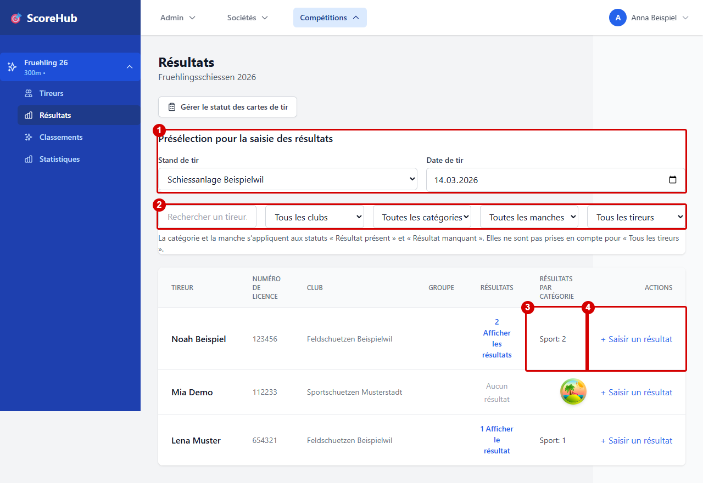
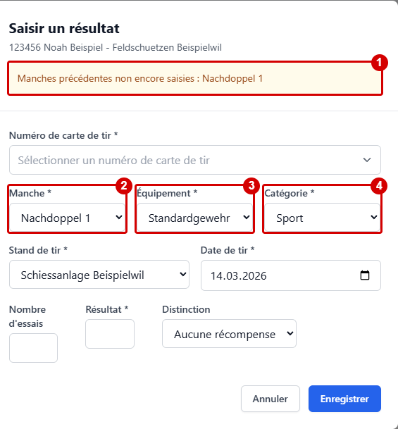
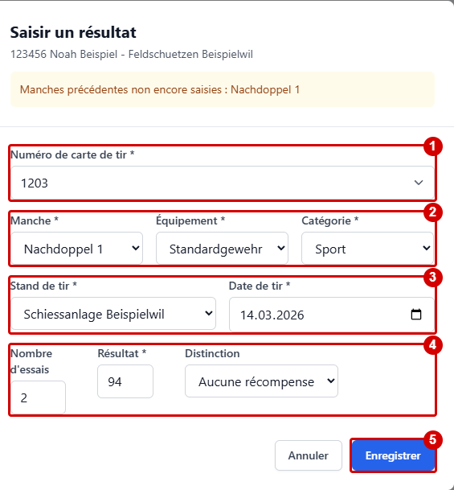

# Résultats et champs de saisie

Le formulaire de résultat dépend en partie de la configuration du concours concerné. Saisissez uniquement des valeurs conformes aux règles du concours et aux indications des champs dans l’application.

## Informations courantes

Selon le concours, les informations suivantes peuvent notamment être disponibles :

- Manche et catégorie
- Résultat
- Site et jour de tir
- Équipement
- Distinction
- Nombre de coups d’essai
- Champs de résultat supplémentaires définis pour le concours

Toutes les informations ne sont pas activées ni obligatoires pour chaque concours. Le formulaire ou la validation indique les champs obligatoires et les valeurs maximales éventuelles.

## Saisir un résultat

Dans le concours, ouvrez la section **Résultats**. Les exemples ci-dessous utilisent uniquement des données fictives ; les cadres rouges ont été ajoutés pour ce guide.

### Liste des tireurs et préparation

1. Présélectionnez au besoin le stand et la date de tir pour les prochaines saisies.
2. Recherchez ou filtrez les tireurs par club, catégorie, manche et statut du résultat.
3. Vérifiez le nombre de résultats déjà saisis par catégorie.
4. Ouvrez **Saisir un résultat** pour le tireur souhaité.

### Proposition de manche et manches manquantes

Dans cet exemple, la manche initiale et Nachdoppel 2 sont déjà saisies, mais Nachdoppel 1 ne l’est pas encore.

1. L’indication signale la manche précédente encore manquante.
2. La manche manquante **Nachdoppel 1** est proposée.
3. L’équipement est repris de la première manche.
4. La catégorie est également reprise. Vérifiez et modifiez les propositions si nécessaire ; la capture montre les valeurs avant toute modification manuelle.

### Renseigner et enregistrer

1. Si le suivi est activé, sélectionnez un numéro de feuille de stand valide.
2. Vérifiez la manche, l’équipement et la catégorie et modifiez-les si nécessaire.
3. Vérifiez le stand et la date de tir.
4. Saisissez le résultat et les autres valeurs obligatoires, selon le format et le barème du concours.
5. Sélectionnez **Enregistrer**, puis vérifiez l’entrée dans la liste.

L’application valide les données saisies. L’interface doit indiquer que l’enregistrement a réussi. Ne comptez pas sur une sauvegarde automatique intermédiaire ; enregistrez explicitement à l’aide de l’action proposée.

L’application propose la première manche manquante pour les catégories déjà saisies dans la première manche. Elle reprend la catégorie et l’équipement de cette première manche ; à manche égale, la catégorie saisie en premier est proposée d’abord. Si aucun résultat n’existe dans la première manche, choisissez vous-même la catégorie et l’équipement. Lorsque toutes les catégories connues sont complètes, la manche reste vide afin de permettre la saisie manuelle d’une autre catégorie. Vous pouvez modifier les valeurs proposées. Les manches précédentes manquantes de la catégorie choisie sont indiquées en haut du formulaire.

La liste des tireurs affiche le nombre de résultats saisis par catégorie. Filtrez par club, catégorie et manche, puis choisissez les résultats présents ou manquants. La catégorie et la manche doivent correspondre au même résultat ; elles ne s’appliquent pas à **Tous les tireurs**. En cas d’accès limité, les résultats des autres clubs ne sont pas disponibles et ne sont pas considérés comme manquants.

## Numéro et statut de la feuille de stand

Si le suivi est activé, sélectionnez également un **Numéro de feuille de stand** dans la boîte de dialogue du résultat. Seuls les numéros disponibles et non encore retournés du club auquel le tireur est rattaché dans la liste des tireurs du concours sont proposés. Cela s’applique également à l’administration du concours et aux personnes chargées de saisir les résultats sans restriction. Les personnes dont la saisie est limitée ne travaillent que pour leur propre club.

Sur la même page, le formulaire distinct de statut des feuilles de stand permet de signaler des numéros ou des plages comme **Mal remplie** ou **Manquante**, sans sélectionner de résultat ni de tireur. En revanche, l’administration du concours enregistre l’envoi et le retour physique sous **Configuration → Décompte**.

Instructions et tableau des rôles : [Suivi des feuilles de stand](../competitions/data-sheet-tracking.md).

## Erreurs de saisie

- **Un champ obligatoire manque :** renseignez le champ signalé.
- **Valeur hors de la plage autorisée :** vérifiez la configuration de la manche et des catégories ou demandez conseil à l’administration du concours.
- **Mauvaise manche :** sélectionnez la bonne manche dans le formulaire. Un résultat déjà enregistré peut également être corrigé.
- **Mauvais tireur :** annulez et sélectionnez le bon tireur.
- **Impossible d’enregistrer :** vérifiez votre rôle pour le concours et, si la saisie est limitée, votre rattachement au club.

Suite : [Démarrage rapide](quick-start.md) · [Corriger les résultats](editing-results.md)
