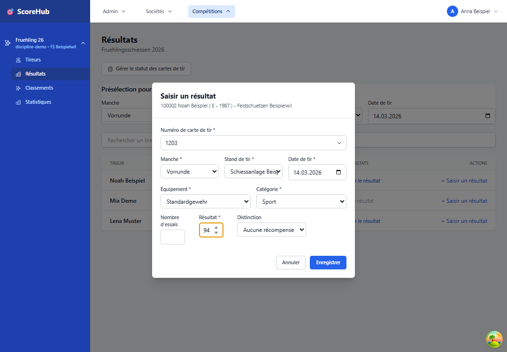

# Démarrage rapide - Résultats

Ce guide décrit la saisie d’un résultat. Vous devez avoir accès au concours et disposer du rôle approprié pour saisir les résultats.

Pour suivre la procédure complète — première connexion, données du club, ajout de tireurs, résultats et classement — consultez le [guide de démarrage rapide pour la saisie des résultats](../getting-started/result-scorer-quick-start.md).

## En six étapes

1. Ouvrez le concours souhaité depuis le tableau de bord ou la navigation.
2. Ouvrez **Tireurs** et vérifiez que la personne a déjà été ajoutée au concours. Si ce n’est pas le cas, choisissez **Ajouter un tireur**, recherchez la personne et ajoutez-la une seule fois. Cette étape se fait dans la section distincte **Tireurs**, et non sous **Résultats**. Pour plus de détails : [Gérer les participants](../competitions/manage-participants.md).
3. Accédez ensuite à **Résultats** et recherchez le tireur ajouté.
4. Choisissez la manche et la catégorie appropriées.
5. Saisissez le résultat ainsi que tous les champs obligatoires signalés, par exemple le site, la date, l’équipement ou la distinction.
6. Enregistrez l’entrée et vérifiez qu’elle apparaît dans la liste des résultats.

Les champs obligatoires dépendent de la configuration du concours. En cas d’erreur, vérifiez d’abord les champs obligatoires signalés et les limites configurées pour la manche.

## Avant la saisie

- Assurez-vous d’avoir ouvert le bon concours et le bon tireur.
- Munissez-vous du résultat officiel et retranscrivez-le avec soin.
- Si vos droits de saisie sont limités à votre club, les données affichées sont automatiquement filtrées sur ce club. Il n’est pas nécessaire de choisir un club supplémentaire.

Suite : [Résultats et champs de saisie en détail](entering-results.md) · [Corriger un résultat](editing-results.md)
