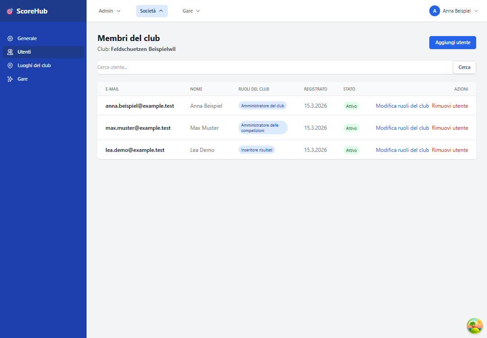

# Gestire gli utenti della società

La pagina **Utenti** mostra le associazioni degli utenti alla società attualmente selezionata. È prevista per la gestione da parte degli amministratori di sistema e della società.

## Associare un utente esistente

1. Nella sezione della società, apri **Utenti**.
2. Seleziona l'azione per aggiungere un utente.
3. Cerca un account Score_Hub già esistente.
4. Seleziona l'account corretto e aggiungilo alla società.

In questo modo viene associato un account utente esistente; l'interfaccia non serve per importare in blocco i membri né per inviare inviti e-mail.

## Modificare il ruolo nella società

1. Cerca la persona nell'elenco degli utenti della società.
2. Apri la modifica del ruolo della società.
3. Seleziona il ruolo appropriato e salva la modifica.

L'interfaccia supporta ruoli quali amministrazione della società, gestione delle competizioni e inserimento dei risultati. Assegna solo le autorizzazioni necessarie per l'attività.

## L'utente non viene trovato?

Verifica l'ortografia del termine cercato. Per associare un utente è necessario che esista già un account Score_Hub. Per creare un nuovo account o se non è disponibile l'azione di modifica, contatta l'amministrazione di sistema o della società.

Continua: [Ruoli e autorizzazioni](../getting-started/roles.md) · [Dati della società](setup-club.md)
