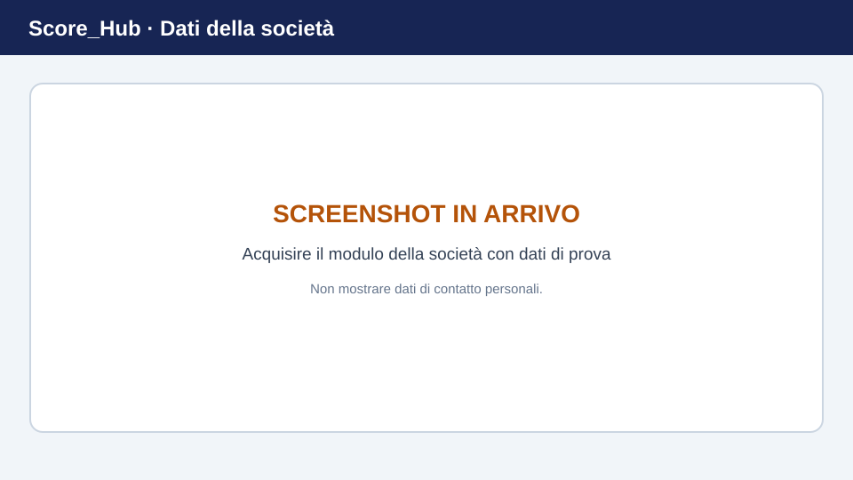

# Gestire i dati della società

Nella sezione della società, gli utenti autorizzati possono modificare i dati principali della società attualmente associata al proprio account. Non tutti gli utenti possono creare una nuova società. Se la tua società non è disponibile o non è associata al tuo account, contatta l'amministrazione di sistema.

> **Immagine segnaposto:** sostituisci questa grafica con uno screenshot aggiornato. Dettagli: [Sostituire gli screenshot](../screenshots.md).

## Aprire e modificare i dati principali

1. Accedi e apri la sezione della società dalla navigazione.
2. Seleziona **Generale** o i dati principali della società.
3. Controlla le informazioni presenti. In base al modello dei dati, possono includere il nome della società, il nome abbreviato, l'indirizzo, il codice postale, la località, il cantone e il logo.
4. Seleziona **Modifica informazioni**, apporta le modifiche e salva.
5. Dopo il salvataggio, controlla i dati visualizzati.

La possibilità di modificare dipende dal fatto che tu sia amministratore di sistema o della società.

## Altre sezioni della società

- In **Utenti**, le persone autorizzate gestiscono le associazioni e i ruoli degli utenti Score_Hub.
- In **Poligoni**, gestisci i poligoni associati alla società.
- In **Competizioni**, crei e gestisci le competizioni della società.

Queste sezioni consentono di inserire solo i campi disponibili nell'applicazione. Questa guida non comprende funzioni quali quote associative, newsletter, prenotazioni o importazioni massive di file.

Continua: [Utenti della società](manage-members.md) · [Poligoni](manage-locations.md) · [Competizioni](../competitions/create-competition.md)
