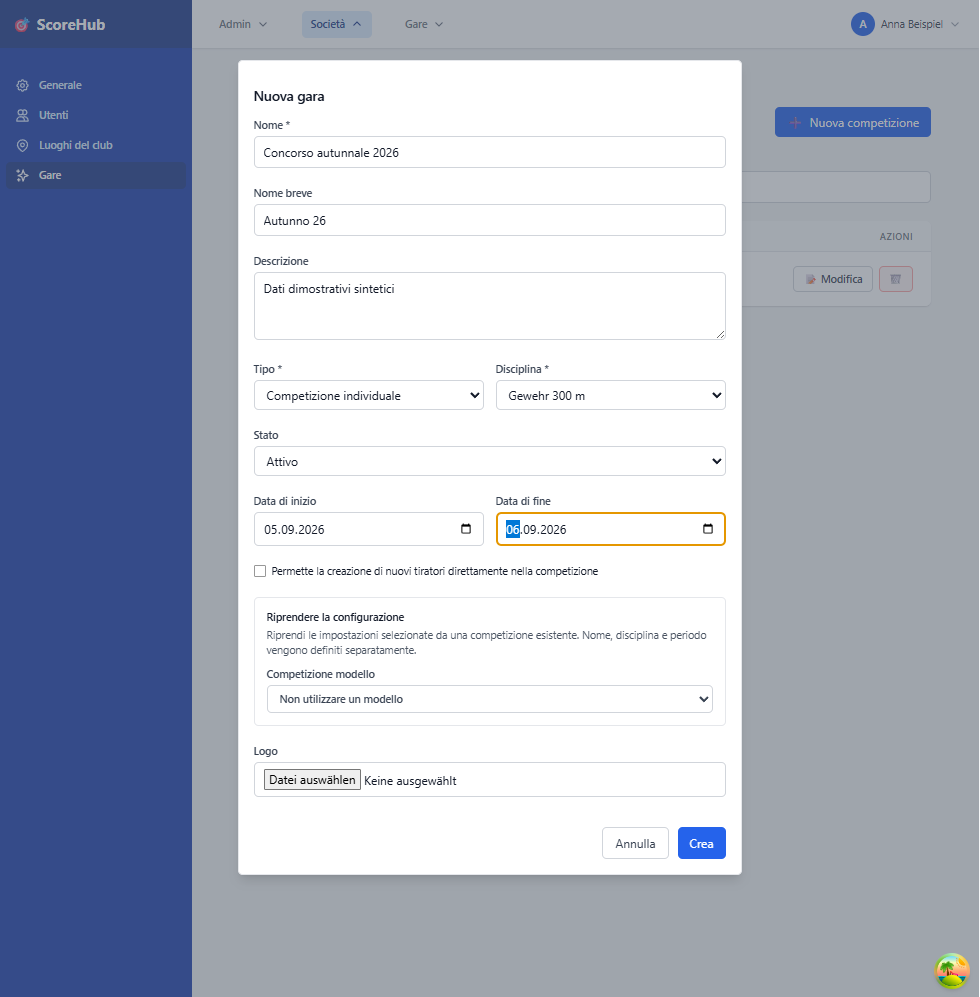

# Creare una competizione

Le competizioni si gestiscono nella sezione della società. Per crearle o modificarle è necessario disporre delle autorizzazioni appropriate della società o di sistema.

## Creare una nuova competizione

1. Apri **Società → Competizioni**.
2. Seleziona l'azione per creare una competizione.
3. Inserisci i dati di base richiesti. In particolare, nome, nome abbreviato, descrizione, tipo, stato, disciplina e date di inizio e fine.
4. Facoltativamente, puoi selezionare come modello una competizione esistente della stessa società. Poi indica singolarmente quali categorie, turni, programma di tiro, matrice dei riconoscimenti, prezzi e regole sulle munizioni, nonché classifiche, copiare. La matrice dei riconoscimenti e le regole sui prezzi sono selezionabili solo se vengono copiate anche categorie e turni.
5. Salva la competizione. Comparirà quindi nell'elenco della società. Le configurazioni copiate vengono associate alla nuova competizione; dovrai inserire personalmente i dati di base, come nome, disciplina e periodo, per la nuova competizione.
6. Apri la configurazione della competizione per controllare e, se necessario, modificare categorie, campi risultato, riconoscimenti, contabilità, turni, classifiche e utenti della competizione.

I campi obbligatori sono contrassegnati nel modulo. Pubblica la competizione o modifica il suo stato solo dopo aver verificato che la configurazione sia corretta per la procedura prevista.

## Tipi di competizione

L'applicazione consente di scegliere tra competizioni individuali, a squadre e miste. Le classifiche e i gruppi disponibili dipendono dal tipo selezionato e dalla configurazione.

## Dopo la creazione

- Completa prima la configurazione, in particolare turni, categorie e campi risultato.
- Aggiungi i partecipanti nella sezione **Tiratori**.
- Per le competizioni a squadre, crea i gruppi necessari e assegnavi i partecipanti.
- Assegna i ruoli della competizione solo alle persone che necessitano del relativo accesso.

Continua: [Configurare una competizione](competition-settings.md) · [Gestire i partecipanti](manage-participants.md) · [Inserimento rapido dei risultati](../results/quick-start.md)
