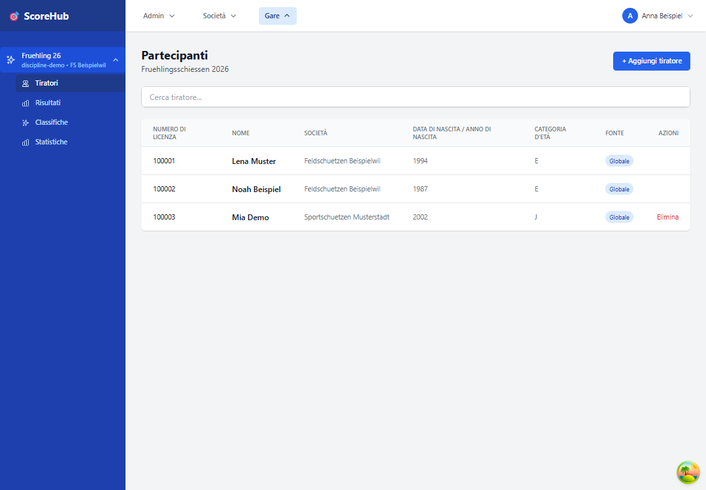

# Tiratori, partecipanti e gruppi

I partecipanti a una competizione si gestiscono nella sezione **Tiratori**. I gruppi e i relativi componenti si gestiscono separatamente nella sezione **Gruppi**.

## Aggiungere tiratori

1. Apri la competizione e passa a **Tiratori**.
2. Cerca un tiratore esistente.
3. Seleziona la voce corretta e aggiungila alla competizione.
4. Se la funzione è disponibile, puoi inserire un nuovo tiratore direttamente nella finestra di aggiunta. Il modulo può includere dati come nome, numero di licenza, data di nascita, società e sesso.
5. Controlla il tiratore nell'elenco dei partecipanti.

L'importazione di elenchi di partecipanti da Excel o CSV non fa parte di questa procedura.

## Modificare o rimuovere i dati di un tiratore

Seleziona il tiratore nell'elenco e usa l'azione di modifica disponibile. Le modifiche o la rimozione potrebbero essere limitate se sono già stati inseriti risultati. Modifica i dati principali con attenzione, perché possono essere utilizzati nei risultati e nelle classifiche.

## Formare i gruppi

1. Passa a **Gruppi**.
2. Se necessario, seleziona la categoria e il turno.
3. Crea un gruppo con un nome univoco.
4. Aggiungi al gruppo i tiratori corretti della competizione.
5. Controlla l'assegnazione per ogni turno e categoria pertinenti.

In base alla configurazione della competizione, i gruppi possono essere gestiti per turno e categoria. Prima di inserire i risultati, verifica che le assegnazioni siano corrette.

Continua: [Configurare una competizione](competition-settings.md) · [Inserimento rapido dei risultati](../results/quick-start.md)
