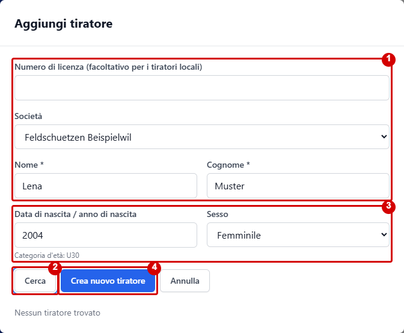
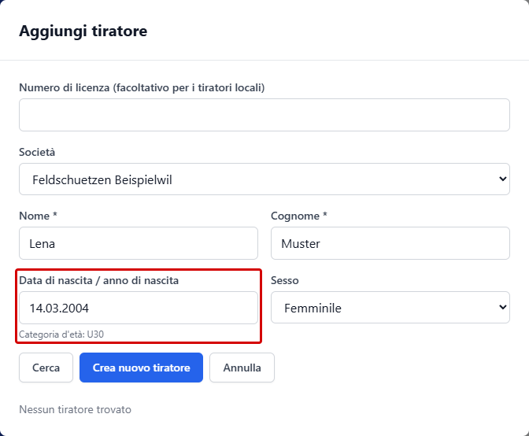

# Tiratori, partecipanti e gruppi

I partecipanti a una competizione si gestiscono nella sezione **Tiratori**. I gruppi e i relativi componenti si gestiscono separatamente nella sezione **Gruppi**.

## Aggiungere tiratori

1. Apri la competizione e passa a **Tiratori**.
2. Seleziona **Aggiungi tiratore** e cerca un tiratore esistente nella finestra.
3. Seleziona la voce corretta tra i risultati e aggiungila alla competizione. Controlla poi l'elenco dei partecipanti.

### Creare un nuovo tiratore

Se non trovi un tiratore adatto, puoi crearlo direttamente nella finestra quando la creazione è abilitata per la competizione. L'accesso dipende dal tuo ruolo. Le immagini mostrano dati fittizi; i contrassegni rossi sono stati aggiunti per questa guida.

1. Inserisci nome e cognome e, se necessario, scegli la società. Il numero di licenza è facoltativo per i tiratori locali.
2. Seleziona **Cerca** per verificare le voci esistenti. Se trovi una voce corretta, selezionala invece di creare un duplicato.
3. Se nessun risultato è adatto, completa l'anno o la data di nascita e, se necessario, il sesso. La categoria d'età visualizzata viene determinata dall'anno di nascita.
4. Seleziona **Crea nuovo tiratore**. Controlla poi la voce nell'elenco dei partecipanti.

### Data o anno di nascita

Il campo **Data di nascita / anno di nascita** accetta entrambi i formati:

- Solo l'anno a quattro cifre, ad esempio `2004`: al salvataggio viene impostata automaticamente la data di nascita **01.01.2004**.
- La data completa, ad esempio `14.03.2004`: questa data viene mantenuta al salvataggio. È accettato anche il formato `2004-03-14`.

Per la categoria d'età è attualmente necessario solo l'anno di nascita. Il campo può rimanere vuoto; in tal caso non viene proposta una categoria d'età dalla data di nascita. La finestra segnala date non valide e anni al di fuori dell'intervallo tra il 1900 e l'anno corrente.

L'importazione di elenchi di partecipanti da Excel o CSV non fa parte di questa procedura.

## Modificare o rimuovere i dati di un tiratore

Seleziona il tiratore nell'elenco e usa l'azione di modifica disponibile. Le modifiche o la rimozione potrebbero essere limitate se sono già stati inseriti risultati. Modifica i dati principali con attenzione, perché possono essere utilizzati nei risultati e nelle classifiche.

Per un tiratore creato localmente puoi correggere o rimuovere il numero di licenza con **Modifica**, anche dopo l'inserimento dei risultati. Salva la modifica e controlla il numero nell'elenco. I risultati e le assegnazioni ai gruppi restano collegati al tiratore. Un numero già assegnato a un altro tiratore della stessa competizione viene rifiutato. I tiratori aggiunti dall'elenco centrale non possono essere modificati qui.

## Formare i gruppi

1. Passa a **Gruppi**.
2. Se necessario, seleziona la categoria e il turno.
3. Crea un gruppo con un nome univoco.
4. Aggiungi al gruppo i tiratori corretti della competizione.
5. Controlla l'assegnazione per ogni turno e categoria pertinenti.

In base alla configurazione della competizione, i gruppi possono essere gestiti per turno e categoria. Prima di inserire i risultati, verifica che le assegnazioni siano corrette.

Continua: [Configurare una competizione](competition-settings.md) · [Inserimento rapido dei risultati](../results/quick-start.md)
