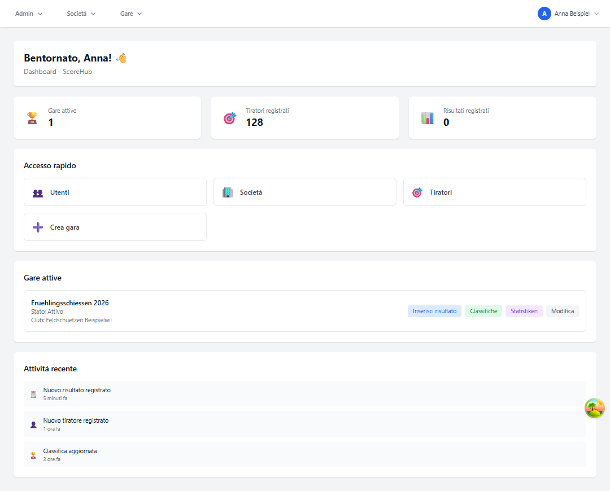

# Dashboard e navigazione

La dashboard è la pagina iniziale dopo l'accesso. Mostra indicatori, azioni rapide e le competizioni disponibili per il tuo account.

## Sezioni della dashboard

- **Competizioni attive:** elenco delle competizioni disponibili, con stato e, se disponibile, nome della società.
- **Azioni rapide:** le azioni visualizzate dipendono dal ruolo. Gli amministratori vedono ulteriori collegamenti di gestione.
- **Indicatori:** i totali visualizzati sono riepiloghi di sistema. Al momento l'indicatore dei risultati non è ancora collegato e può quindi mostrare `0`; non va considerato un conteggio completo dei risultati.

Per una competizione, usa le azioni disponibili per aprire la sezione dei risultati o la classifica. Per configurare una competizione, passa alla sezione della società e apri **Competizioni**.

## Notifiche

La casella delle notifiche si trova sotto l'elenco delle competizioni. Mostra i messaggi più recenti con oggetto, contenuto, data, stato di lettura e numero di messaggi non letti.

**Mostra solo non lette** filtra l'elenco. Usa **Precedente** e **Successivo** per passare da una pagina all'altra; **Aggiorna** ricarica l'elenco. **Apri** porta alla sezione collegata in Score_Hub, se è disponibile un link. **Segna come letta** aggiorna lo stato di lettura. I messaggi letti vengono eliminati dopo il periodo impostato dall'amministrazione di sistema; quelli non letti vengono conservati.

L'amministrazione di sistema configura la casella e l'invio delle notifiche. Per saperne di più: [Notifiche ed e-mail amministrative](../notifications.md).

## Navigazione

La barra laterale raggruppa le sezioni disponibili. In base alle autorizzazioni, potresti vedere:

- **Società:** dati principali, utenti della società, poligoni e competizioni
- **Competizioni:** partecipanti, gruppi, risultati, classifiche e statistiche della competizione aperta
- **Amministrazione:** gestione a livello di sistema di utenti, società e dati principali; solo per gli amministratori di sistema
- **Profilo e lingua:** dati personali e selezione della lingua

Sugli schermi piccoli, la barra laterale potrebbe essere compressa. Usa il pulsante di navigazione per aprirla.

Continua: [Ruoli](roles.md) · [Creare una competizione](../competitions/create-competition.md)
