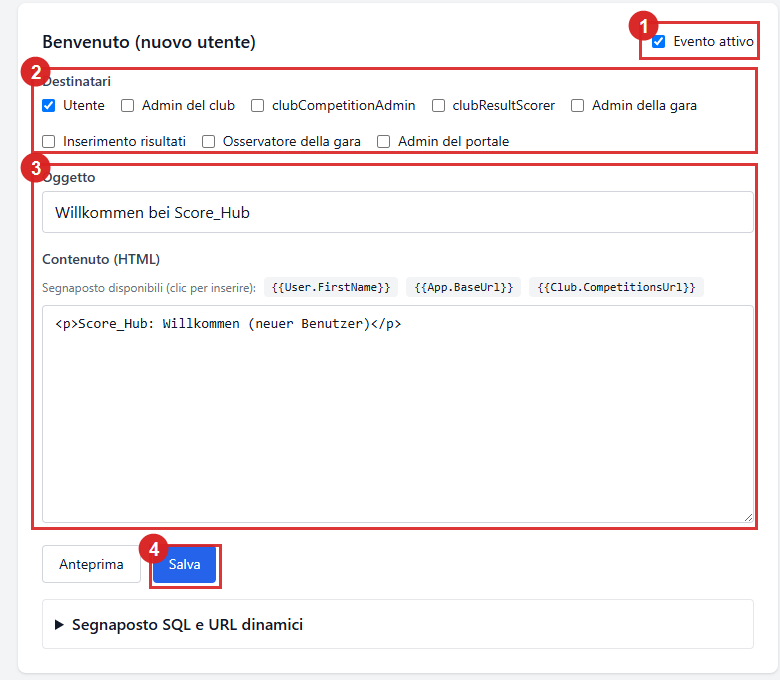
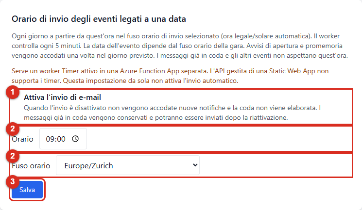
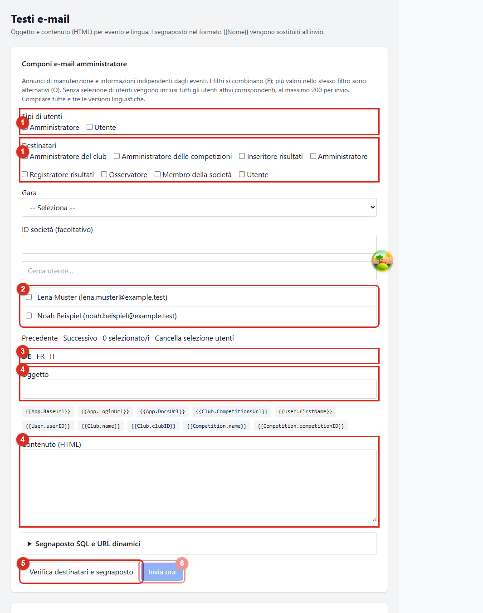

# Notifiche ed e-mail amministrative

Score_Hub invia e-mail automatiche in occasione di alcuni eventi relativi agli account e alle competizioni. Gli amministratori di sistema possono configurare eventi, ruoli dei destinatari e testi. È inoltre disponibile una finestra separata per l'invio manuale di comunicazioni amministrative.

*1 attiva o disattiva l'evento, 2 definisce i ruoli dei destinatari, 3 indica oggetto e contenuto HTML e 4 salva il modello.*

## Eventi, trigger e destinatari

La tabella elenca gli eventi e i ruoli dei destinatari attivi per impostazione iniziale. I ruoli si configurano per ogni evento in **Testi e-mail**. I destinatari devono essere utenti attivi con il ruolo selezionato nella società o nella competizione interessata.

| Evento | Quando si attiva | Destinatari predefiniti |
| --- | --- | --- |
| Benvenuto | Alla registrazione o alla creazione di un account utente | Il nuovo utente |
| Società: utente aggiunto | Quando un utente viene associato a una società | L'utente aggiunto |
| Società: ruolo rimosso | Quando viene rimossa un'assegnazione di ruolo nella società | L'utente interessato |
| Competizione: utente aggiunto | Quando un utente viene associato a una competizione | L'utente aggiunto |
| Competizione: ruolo modificato | Quando, copiando gli utenti da un modello, il ruolo dell'autore viene impostato su amministratore della competizione | L'utente interessato |
| Apertura dell'inserimento risultati | Alla **data di inizio dell'inserimento** della competizione, se nella competizione è attivo l'avviso di apertura | Amministrazione di sistema, amministrazione della società organizzatrice, amministrazione della competizione, chi inserisce i risultati e chi consulta la competizione |
| Scadenza imminente dell'inserimento | Sette giorni prima della **scadenza dell'inserimento** della competizione, se nella competizione è attivo il promemoria | Amministrazione di sistema, amministrazione della società organizzatrice e amministrazione della competizione |

Le ultime due date si riferiscono alla **data di inizio dell'inserimento** e alla **scadenza dell'inserimento**, non alle date di inizio e fine della competizione. Entrambi gli avvisi devono essere attivati in due punti: l'evento in **Testi e-mail** e la relativa opzione nella scheda **Generale** della configurazione della competizione. Il promemoria di scadenza si applica solo se è stata impostata una data limite.

Le notifiche relative all'assegnazione di account o ruoli vengono inviate all'account interessato. Per questi avvisi personali, le regole dei destinatari stabiliscono se la notifica è attiva per l'utente. Le regole relative ai destinatari degli avvisi di inserimento si configurano separatamente.

## Configurare gli eventi automatici

1. Accedi come amministratore di sistema e apri **Amministrazione → Testi e-mail**.
2. Individua l'evento. **Evento attivo** abilita o disabilita l'evento a livello di sistema.
3. In **Destinatari**, seleziona i ruoli a cui inviare il messaggio.
4. Seleziona **de**, **fr** e **it** e inserisci oggetto e contenuto HTML per ogni lingua. Per ogni destinatario viene usato il modello della lingua preferita.
5. Usa i pulsanti dei segnaposto per inserire valori come `{{User.FirstName}}` o `{{Competition.Name}}` nella posizione del cursore.
6. Controlla il modello con **Anteprima** e salva le modifiche dell'evento.

Un evento disattivato non accoda nuovi messaggi. Le modifiche ai modelli riguardano i messaggi futuri; i messaggi già preparati per l'invio mantengono il contenuto generato.

### Orario di invio degli eventi legati a una data

L'impostazione **Orario di invio degli eventi legati a una data** definisce un orario e un fuso di invio a livello di sistema. Il valore predefinito è **09:00 / Europe/Zurich**. Il Timer controlla ogni cinque minuti e accoda gli avvisi di apertura e scadenza a partire dall'orario scelto nel giorno dell'evento. Il giorno dell'evento dipende dal fuso orario della competizione; l'orario dipende dal fuso selezionato qui. La modifica dell'orario o del fuso non reinvia gli eventi già accodati.

*1 sospende o attiva tutti gli invii e-mail, 2 imposta orario e fuso e 3 salva le impostazioni.*

Gli avvisi di benvenuto e assegnazione e le e-mail amministrative manuali non dipendono da questo orario giornaliero. La coda o il fornitore possono ritardare la consegna effettiva.

**Prerequisito operativo:** il Timer deve essere eseguito in una Azure Function App separata. L'API gestita di Azure Static Web Apps non supporta i timer. L'impostazione dell'orario non configura il worker.

### Sospendere globalmente l'invio delle e-mail

La casella **Attiva l'invio di e-mail**, nelle impostazioni dell'orario, consente all'amministrazione di sistema di attivare o disattivare tutti gli invii e-mail. Quando l'invio è disattivato non vengono accodate nuove notifiche e i messaggi in attesa non vengono consegnati. La coda viene conservata; dopo la riattivazione, i messaggi in attesa possono essere elaborati. L'anteprima e il controllo dei destinatari delle e-mail amministrative restano disponibili, ma l'invio è bloccato.

## Segnaposto nei modelli

Ogni evento mette a disposizione segnaposto appropriati; l'elenco sopra il contenuto mostra i valori disponibili. Per esempio, possono includere il nome e i collegamenti della competizione, il nome dell'utente o i collegamenti all'applicazione e alla documentazione. Fai clic su un segnaposto per inserirlo nel contenuto HTML.

La sezione **Segnaposto SQL e URL dinamici** consente di definire valori aggiuntivi:

- **Campo:** legge un singolo campo da una tabella disponibile.
- **Numero (COUNT):** conta i record corrispondenti; se non ci sono record restituisce `0`.
- **URL dinamico:** crea un collegamento con base applicazione o documentazione, percorso relativo ed eventuale ancora.

Ogni query SQL richiede almeno un filtro di contesto, ad esempio `createdBy = ID destinatario` o `competitionID = ID competizione`. Un singolo campo deve identificare esattamente un record. I campi sensibili non vengono proposti. Prima di salvare il modello, verifica oggetto e contenuto usando i valori effettivi dell'evento.

## Inviare un'e-mail amministrativa

*1 indica i tipi di utenti e i ruoli, 2 la selezione individuale, 3 la lingua, 4 oggetto e contenuto, 5 il controllo di destinatari e segnaposto e 6 l'inserimento in coda. L'invio resta bloccato senza un'anteprima valida.*

1. Apri **Amministrazione → Testi e-mail** e la sezione **Invia direttamente agli utenti**.
2. Seleziona almeno un pubblico: utenti specifici, tipi di utenti di sistema, ruoli della società o della competizione ed eventualmente una competizione o un ID società.
3. Inserisci oggetto e contenuto in tedesco, francese e italiano. Per ogni destinatario viene usato il modello della lingua preferita.
4. Aggiungi i segnaposto necessari e seleziona **Controlla destinatari e segnaposto**.
5. Controlla l'anteprima generata per ogni destinatario. Segnaposto mancanti, vuoti o ambigui bloccano l'invio.
6. Seleziona **Invia ora**. Destinatari e contenuto generato vengono inseriti nella coda di invio.

I filtri diversi vengono combinati (AND); più valori nello stesso filtro sono alternativi (OR). Se non viene selezionato alcun utente, vengono inclusi tutti gli utenti attivi che corrispondono agli altri filtri selezionati. Un invio può includere al massimo 200 destinatari e richiede almeno un filtro del pubblico.

Le e-mail amministrative sono comunicazioni manuali, non eventi automatici. L'anteprima e l'accodamento non dipendono dall'orario giornaliero, ma per l'invio effettivo è necessario che l'interruttore globale sia attivo. Il messaggio di conferma indica l'accodamento, non la consegna.

## Preferenze personali e fusi orari

Le impostazioni individuali per evento vengono considerate quando si selezionano i destinatari. Tuttavia, al momento l'interfaccia utente non offre una pagina profilo per modificare tali preferenze. L'amministrazione di sistema gestisce quindi i ruoli destinatari degli eventi automatici.

Il fuso orario del profilo influisce sulla visualizzazione degli istanti. Per le notifiche legate a una data vale il giorno locale della competizione; l'orario giornaliero di invio usa invece il fuso separato configurato a livello di sistema. I limiti di inserimento dei risultati sono inclusivi e vengono verificati in base al fuso orario della competizione. Chi inserisce i risultati può crearli, modificarli ed eliminarli durante questo periodo. Un limite assente lascia aperto il periodo; le competizioni concluse o annullate restano bloccate.

Continua: [Ruoli e autorizzazioni](getting-started/roles.md) · [Configurare una competizione](competitions/competition-settings.md)
