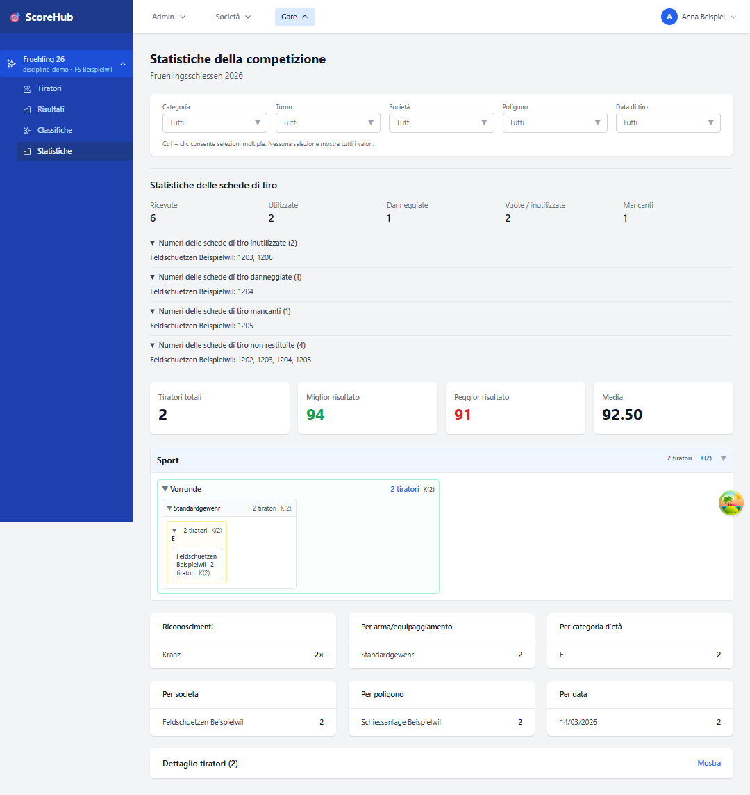

# Statistiche della competizione

La pagina **Statistiche** riepiloga i risultati della competizione aperta. Le analisi visualizzate dipendono dai risultati disponibili e dai filtri utilizzabili.

## Leggere le statistiche

1. Apri la competizione e seleziona **Statistiche**.
2. Scegli i filtri disponibili, ad esempio categoria, società, poligono o giornata di tiro.
3. Esamina gli indicatori e le tabelle tenendo conto della selezione effettuata.

Le sezioni vuote non significano necessariamente che la competizione non contenga risultati. Controlla prima i filtri e la categoria. Gli indicatori si riferiscono solo ai dati e alle selezioni rappresentati nell'applicazione.

## Disponibilità e restituzione dei fogli di stand

Se il [tracciamento dei fogli di stand](../competitions/data-sheet-tracking.md) è attivo, le statistiche mostrano i fogli ricevuti, utilizzati, compilati male, inutilizzati e dichiarati esplicitamente mancanti. Gli elenchi espandibili riportano i numeri non utilizzati, quelli compilati male o mancanti e quelli non ancora restituiti. Anche il filtro per società limita questi conteggi e questi elenchi; chi inserisce i risultati con accesso limitato vede solo la propria società.

Il consumo e la restituzione sono distinti: un foglio con un risultato registrato potrebbe non essere ancora stato restituito. Un foglio restituito senza essere stato utilizzato continua a essere conteggiato come inutilizzato, ma non risulta più tra le restituzioni in sospeso. L'effettiva restituzione viene registrata dall'amministrazione della competizione in **Configurazione → Contabilità**, indicando i numeri esatti.

Se è disponibile **Contabilità in PDF**, la stampa include i conteggi dei fogli di stand filtrati per società, compresi quelli compilati male, inutilizzati e ancora da restituire. Gli elenchi dei numeri non vengono stampati.

## Esportazione in PDF

Se la pagina offre un'azione per generare un PDF, controlla la selezione e i filtri prima di creare il file. Per ulteriori analisi, usa i risultati sottostanti o rivolgiti all'amministrazione della competizione.

Continua: [Consultare le classifiche](view-rankings.md)
