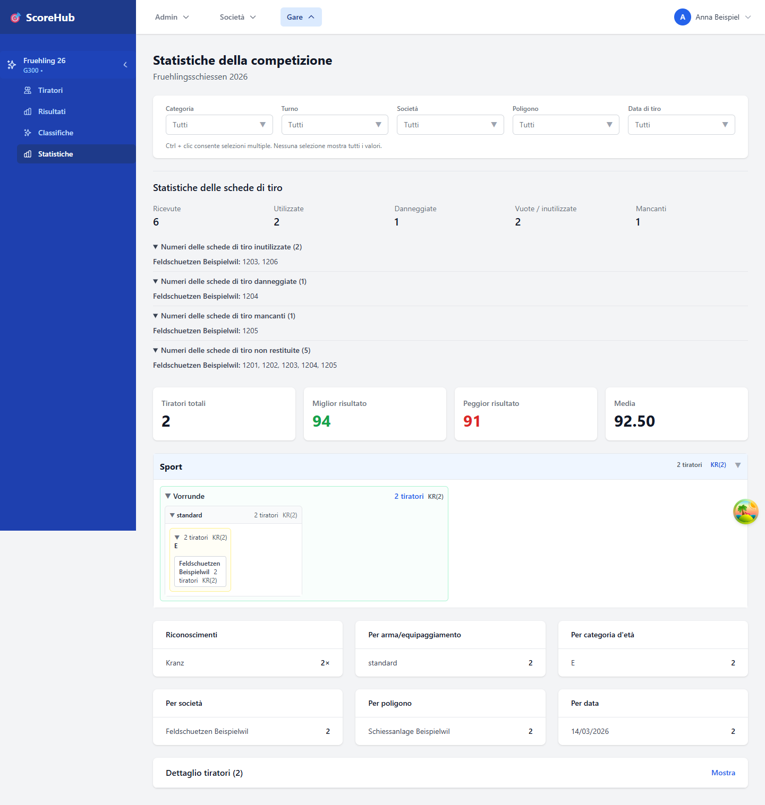

# Statistiche della competizione

La pagina **Statistiche** riepiloga i risultati della competizione aperta. Le analisi visualizzate dipendono dai risultati disponibili e dai filtri utilizzabili.

## Leggere le statistiche

1. Apri la competizione e seleziona **Statistiche**.
2. Scegli i filtri disponibili, ad esempio categoria, società, poligono o giornata di tiro.
3. Esamina gli indicatori e le tabelle tenendo conto della selezione effettuata.

Le sezioni vuote non significano necessariamente che la competizione non contenga risultati. Controlla prima i filtri e la categoria. Gli indicatori si riferiscono solo ai dati e alle selezioni rappresentati nell'applicazione.

## Disponibilità e restituzione dei fogli di stand

Se il [tracciamento dei fogli di stand](../competitions/data-sheet-tracking.md) è attivo, le statistiche mostrano il numero di fogli ricevuti, utilizzati, compilati male, restituiti vuoti e dichiarati esplicitamente mancanti. Il filtro per società limita questi conteggi; chi inserisce i risultati con accesso limitato vede solo la propria società. I singoli numeri sono disponibili nella pagina **Schede di tiro** della competizione.

**Vuote / restituite** conta solo i fogli restituiti senza essere stati utilizzati. Sono esclusi i fogli restituiti già utilizzati o compilati male. L'amministrazione della competizione o di sistema registra la restituzione nella pagina **Schede di tiro**.

Se è disponibile **Contabilità in PDF**, la stampa include i conteggi filtrati per società, comprese le schede restituite vuote. Gli elenchi dei numeri non vengono stampati.

Senza tracciamento dei numeri, le registrazioni per quantità non indicano lo stato dei fogli. Il PDF riporta quindi la quantità restituita come **Schede restituite (senza stato)**.

## Esportazione in PDF

Se la pagina offre un'azione per generare un PDF, controlla la selezione e i filtri prima di creare il file. Per ulteriori analisi, usa i risultati sottostanti o rivolgiti all'amministrazione della competizione.

## Lotto di PDF in uno ZIP

Quando l’output contabile PDF è attivo, accanto compare **Lotto PDF (ZIP)**. Per impostazione predefinita, il dialogo crea un documento contabile per società con tutte le categorie selezionate insieme. Anche le società con fogli di stand ma senza risultati corrispondenti ricevono un documento.

1. Imposta i filtri nella pagina delle statistiche.
2. Apri **Lotto PDF (ZIP)** e scegli società, categoria, turno, poligono o data di tiro. I criteri selezionati vengono combinati.
3. Se necessario, attiva il **PDF complessivo**: aggiunge un documento contabile senza questi raggruppamenti, mantenendo i filtri attuali.
4. Scarica lo ZIP con i singoli PDF.

I documenti solo per società e quello complessivo includono le quantità e i costi pertinenti dei fogli di stand. Un raggruppamento per categoria, turno, poligono o data produce un’**analisi statistica, non contabilità**: non vengono stampati importi e le quantità di fogli non attribuibili sono indicate con **0**. Il consumo e le quantità di munizioni ricavabili dai risultati restano visibili. Le società senza risultati corrispondenti ricevono un documento aggiuntivo per società, anziché una suddivisione inventata.

Sono selezionabili solo criteri con almeno due valori visibili. Chi è limitato alla propria società esporta soltanto quella; **Società** rimane disattivata. La restrizione vale anche per i fogli di stand e il PDF complessivo.

Continua: [Consultare le classifiche](view-rankings.md)
