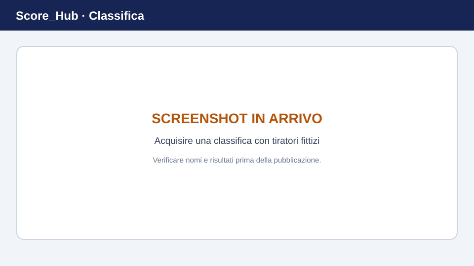

# Consultare le classifiche

Le classifiche di una competizione si trovano nella sezione **Classifiche**. I punteggi visualizzati dipendono dalle classifiche, dalle categorie e dai risultati configurati per la competizione.

> **Immagine segnaposto:** sostituisci questa grafica con uno screenshot aggiornato. Dettagli: [Sostituire gli screenshot](../screenshots.md).

## Selezionare e filtrare una classifica

1. Apri la competizione e seleziona **Classifiche**.
2. Seleziona la categoria e, se disponibile, la classifica.
3. Usa i filtri disponibili, ad esempio società, poligono o giornata di tiro.
4. Controlla i risultati e la posizione visualizzata.

Una classifica potrebbe essere vuota se non sono ancora stati inseriti risultati pertinenti oppure se i filtri non restituiscono corrispondenze. Reimposta i filtri e verifica che l'amministrazione della competizione abbia configurato la classifica.

## Salvare una classifica in PDF

Se disponibile per il tuo ruolo, usa l'azione PDF della classifica. Prima di esportare, controlla la categoria e i filtri selezionati. Questa guida non presuppone che siano disponibili altri formati di esportazione, come Excel o CSV.

## Dettagli dei risultati

Se necessario, apri la vista dettagli della classifica disponibile per consultare i risultati associati. Le classifiche riflettono i dati salvati e la configurazione. Se rilevi una discrepanza, controlla prima i risultati, la categoria e i filtri.

Continua: [Statistiche](statistics.md) · [Correggere i risultati](../results/editing-results.md)
