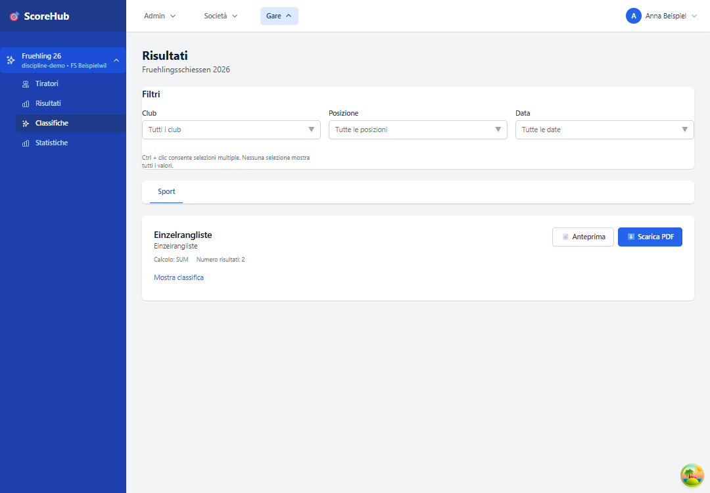

# Consultare le classifiche

Le classifiche di una competizione si trovano nella sezione **Classifiche**. I punteggi visualizzati dipendono dalle classifiche, dalle categorie e dai risultati configurati per la competizione.

## Selezionare e filtrare una classifica

1. Apri la competizione e seleziona **Classifiche**.
2. Seleziona la categoria e, se disponibile, la classifica.
3. Usa i filtri disponibili, ad esempio società, poligono o giornata di tiro.
4. Controlla i risultati e la posizione visualizzata.

Una classifica potrebbe essere vuota se non sono ancora stati inseriti risultati pertinenti oppure se i filtri non restituiscono corrispondenze. Reimposta i filtri e verifica che l'amministrazione della competizione abbia configurato la classifica.

I criteri di ordinamento vengono applicati nell'ordine configurato. Per la visualizzazione e l'ordinamento, i campi numerici aggiuntivi usano lo stesso calcolo complessivo: somma, media o valore della manche con il risultato migliore. Se più risultati sono uguali, viene considerata la prima manche corrispondente. Un valore numerico aggiuntivo mancante in quella manche viene visualizzato e ordinato come 0.

Nella configurazione della classifica puoi scegliere la colonna normale delle distinzioni oppure la variante compatta **Dist.**. Entrambe mostrano gli stessi valori.

## Salvare una classifica in PDF

Se disponibile per il tuo ruolo, usa l'azione PDF della classifica. Prima di esportare, controlla la categoria e i filtri selezionati. Questa guida non presuppone che siano disponibili altri formati di esportazione, come Excel o CSV.

## Salvare più classifiche in ZIP

Per un'esportazione diretta, fai clic su **PDF di tutte le categorie** per la classifica desiderata. Senza un'altra finestra di dialogo, viene scaricato uno ZIP contenente esattamente un PDF per categoria con risultati. I filtri di società, poligono e data e le restrizioni alla propria società vengono mantenuti; la scheda di categoria attiva non limita questa esportazione. Le categorie vuote vengono saltate. Durante la creazione viene mostrato l'avanzamento.

Per un'ulteriore suddivisione per società, poligono o data, usa l'esportazione in batch:

La finestra propone solo suddivisioni con almeno due valori distinti nei dati attualmente filtrati e visibili per te. Gli altri criteri sono in grigio e non selezionabili. Se puoi vedere solo i risultati della tua società, **Club** resta sempre disattivato. Questa autorizzazione si applica al caricamento delle opzioni, a ogni PDF, alle classifiche generali e a **PDF di tutte le categorie**. Senza una società attuale, gli utenti soggetti a questa restrizione non possono esportare. Se tutti i criteri sono disattivati, è comunque possibile esportare le classifiche generali per categoria.

1. Fai clic su **Esportazione in batch** per la classifica desiderata.
2. In **Classifica per**, seleziona società, poligono e/o data di tiro. Le categorie vengono sempre separate automaticamente: viene creato, ad esempio, un PDF per società e per categoria con risultati. Più criteri producono un PDF per ogni combinazione presente e categoria.
3. Attiva o disattiva **Includere anche una classifica generale per categoria**. Viene così creato un PDF aggiuntivo senza la suddivisione selezionata per ogni categoria con risultati.
4. Fai clic su **Scaricare ZIP**. Dopo la creazione di tutti i PDF, viene scaricato un archivio ZIP da salvare.

L'esportazione in batch comprende tutte le categorie indipendentemente dalla scheda selezionata. Gli altri filtri si applicano a tutti i PDF e alle classifiche generali. Le restrizioni alla propria società restano attive. Le categorie e le combinazioni senza risultati vengono saltate. Se in un risultato manca una categoria o un criterio selezionato, un messaggio chiede di completare i dati o modificare la suddivisione. In caso di errore non viene scaricato un archivio incompleto. Le azioni PDF esistenti restano disponibili.

## Dettagli dei risultati

Se necessario, apri la vista dettagli della classifica disponibile per consultare i risultati associati. Le classifiche riflettono i dati salvati e la configurazione. Se rilevi una discrepanza, controlla prima i risultati, la categoria e i filtri.

Continua: [Statistiche](statistics.md) · [Correggere i risultati](../results/editing-results.md)
