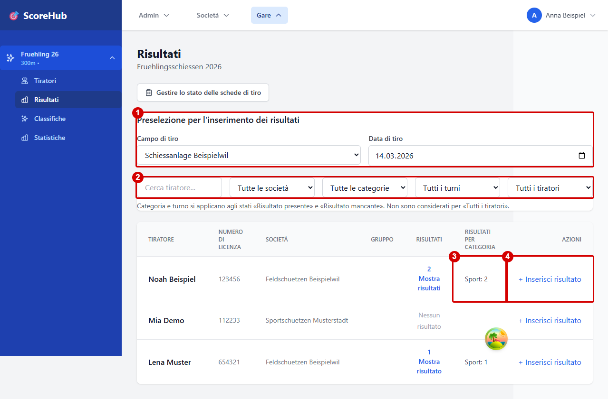
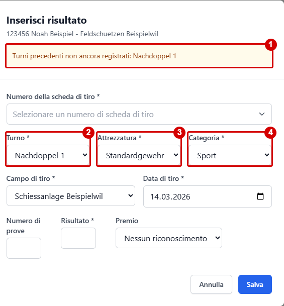
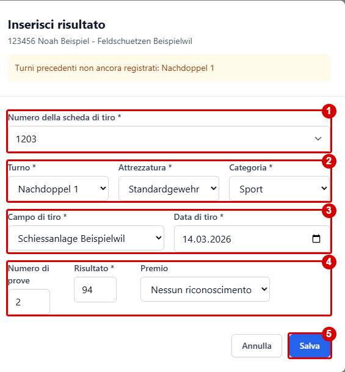

# Risultati e campi di inserimento

La maschera dei risultati dipende in parte dalla configurazione della competizione. Inserisci solo valori conformi al regolamento e alle indicazioni dei campi nell'applicazione.

## Dati tipici

A seconda della competizione, possono essere disponibili i seguenti dati:

- Turno e categoria
- Risultato
- Poligono e giornata di tiro
- Attrezzatura
- Riconoscimento
- Numero di colpi di prova
- Campi risultato aggiuntivi definiti dalla competizione

Non tutti i dati sono attivi o obbligatori in ogni competizione. I campi obbligatori ed eventuali valori massimi sono indicati nella maschera o durante la convalida.

## Inserire un risultato

Nella competizione apri la sezione **Risultati**. Gli esempi seguenti utilizzano solo dati fittizi; i riquadri rossi sono stati aggiunti per questa guida.

### Elenco dei tiratori e preparazione

1. Se necessario, preseleziona campo e data di tiro per gli inserimenti successivi.
2. Cerca o filtra i tiratori per società, categoria, turno e stato del risultato.
3. Controlla quanti risultati sono già registrati per categoria.
4. Apri **Inserisci risultato** per il tiratore desiderato.

### Turno proposto e turni mancanti

Nell’esempio il turno iniziale e Nachdoppel 2 sono già registrati, mentre Nachdoppel 1 non è ancora stato registrato.

1. L’avviso indica il turno precedente ancora mancante.
2. Viene proposto il turno mancante **Nachdoppel 1**.
3. L’attrezzatura viene ripresa dal primo turno.
4. Anche la categoria viene ripresa. Controlla e modifica le proposte se necessario; l’immagine mostra i valori prima di una modifica manuale.

### Compilare e salvare

1. Se il tracciamento è attivo, seleziona un numero di foglio di stand valido.
2. Controlla turno, attrezzatura e categoria e modificali se necessario.
3. Controlla campo e data di tiro.
4. Inserisci il risultato e gli altri valori obbligatori secondo il formato e il sistema di punteggio della competizione.
5. Seleziona **Salva** e controlla la voce nell’elenco.

L'applicazione convalida i dati inseriti. Il buon esito del salvataggio dovrebbe essere visibile nell'interfaccia. Non fare affidamento sul salvataggio automatico; salva esplicitamente con l'azione disponibile.

L’applicazione propone il primo turno mancante per le categorie già registrate nel primo turno. Riprende categoria e attrezzatura dal primo turno; a parità di turno propone prima la categoria registrata per prima. Se non esiste ancora un risultato nel primo turno, scegli tu categoria e attrezzatura. Quando tutte le categorie note sono complete, il turno rimane vuoto per consentire l’inserimento manuale di un’altra categoria. Puoi modificare i valori proposti. I turni precedenti mancanti della categoria scelta sono indicati in cima al modulo.

L’elenco dei tiratori mostra il numero di risultati registrati per categoria. Filtra per società, categoria e turno, quindi scegli se mostrare i risultati presenti o mancanti. Categoria e turno devono corrispondere allo stesso risultato; non si applicano a **Tutti i tiratori**. Con accesso limitato, i risultati delle altre società non sono disponibili e non sono considerati mancanti.

## Numero e stato del foglio di stand

Se il tracciamento è attivo, nel modulo del risultato seleziona anche un **numero di foglio di stand**. Sono disponibili solo i numeri non ancora utilizzati e non restituiti della società a cui appartiene il tiratore nell'elenco dei tiratori della competizione. Questo vale anche per gli amministratori della competizione e per chi inserisce risultati senza limitazioni. Chi ha accesso limitato inserisce i risultati solo per la propria società.

Nella stessa pagina, un modulo separato per lo stato dei fogli di stand consente di segnalare numeri o intervalli come **Compilato male** o **Mancante**, senza selezionare un risultato o un tiratore. L'amministrazione della competizione registra invece l'invio e la restituzione fisica in **Configurazione → Contabilità**.

Guida e matrice dei ruoli: [Tracciamento dei fogli di stand](../competitions/data-sheet-tracking.md).

## Errori durante l'inserimento

- **Manca un campo obbligatorio:** compila il campo contrassegnato.
- **Valore fuori dall'intervallo consentito:** controlla le impostazioni del turno e della categoria oppure chiedi all'amministrazione della competizione.
- **Turno errato:** seleziona il turno corretto nel modulo. Puoi correggere anche un risultato già salvato.
- **Tiratore errato:** annulla e seleziona il tiratore corretto.
- **Impossibile salvare:** controlla il tuo ruolo nella competizione e, se l'accesso è limitato, l'associazione alla società.

Continua: [Guida rapida](quick-start.md) · [Correggere i risultati](editing-results.md)
