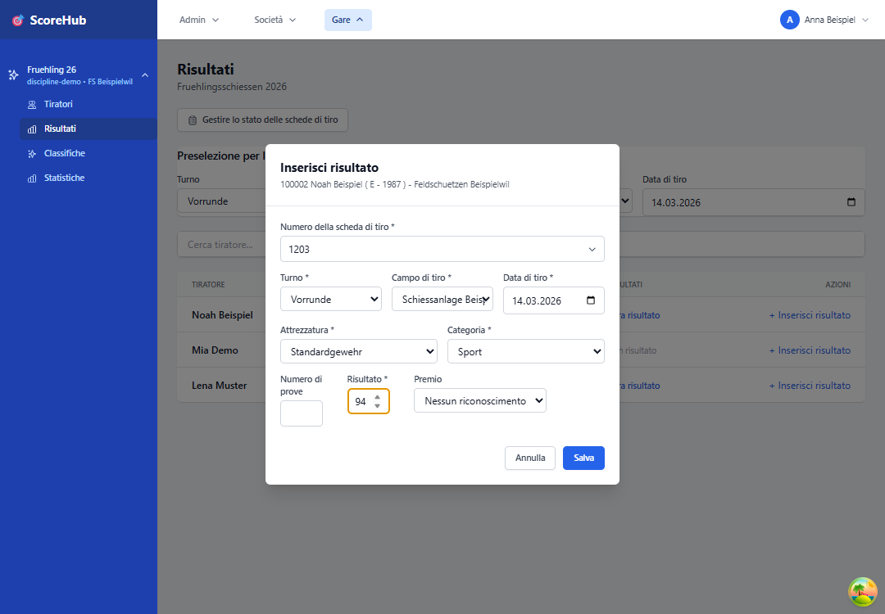

# Risultati: guida rapida

Questa guida illustra l'inserimento di un singolo risultato. È necessario avere accesso alla competizione e il ruolo appropriato per l'inserimento dei risultati.

Per la procedura rapida completa — primo accesso, dati della società, aggiunta di tiratori, risultati e classifica — consulta la [Guida rapida per chi inserisce i risultati](../getting-started/result-scorer-quick-start.md).

## Sei passaggi

1. Apri la competizione desiderata dalla dashboard o dalla navigazione.
2. Apri **Tiratori** e verifica che la persona sia già stata aggiunta alla competizione. In caso contrario, seleziona **Aggiungi tiratore**, cerca la persona e aggiungila. Questo passaggio si esegue nella sezione **Tiratori**, non in **Risultati**. Dettagli: [Gestire i partecipanti](../competitions/manage-participants.md).
3. Poi passa a **Risultati** e cerca il tiratore aggiunto.
4. Seleziona il turno e la categoria corretti.
5. Inserisci il risultato e tutti i campi contrassegnati come obbligatori, ad esempio poligono, data, attrezzatura o riconoscimento.
6. Salva la voce e verifica che appaia nell'elenco dei risultati.

I campi obbligatori dipendono dalla configurazione della competizione. In caso di errore, controlla prima i campi obbligatori contrassegnati e i limiti configurati per il turno.

## Prima di inserire i dati

- Verifica di aver aperto la competizione e il tiratore corretti.
- Tieni a disposizione il risultato ufficiale e trascrivilo con attenzione.
- Se le tue autorizzazioni sono limitate alla tua società, i dati visualizzati vengono filtrati automaticamente in base a essa. Non è necessario selezionare un'altra società.

Continua: [Risultati e campi nel dettaglio](entering-results.md) · [Correggere un risultato](editing-results.md)
