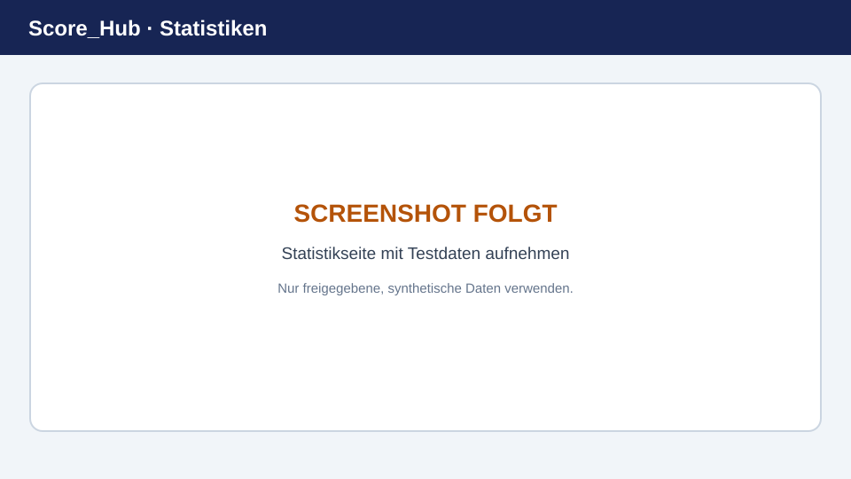

# Wettkampfstatistiken

Die Seite **Statistiken** fasst die Resultate des geöffneten Wettkampfs zusammen. Welche Auswertungen erscheinen, hängt von vorhandenen Resultaten und den verfügbaren Filtern ab.

> **Platzhalterbild:** Ersetzen Sie diese Grafik durch einen aktuellen Screenshot. Details: [Screenshots ersetzen](../screenshots.md).

## Statistiken lesen

1. Öffnen Sie den Wettkampf und wählen Sie **Statistiken**.
2. Wählen Sie verfügbare Filter wie Kategorie, Verein, Standort oder Schiesstag.
3. Prüfen Sie Kennzahlen und Tabellen im Zusammenhang mit der gewählten Auswahl.

Leere Bereiche bedeuten nicht zwingend, dass der Wettkampf keine Resultate enthält. Prüfen Sie zuerst Filter und Kategorie. Kennzahlen sind nur für die in der Anwendung dargestellten Daten und Auswahlbereiche gültig.

## Standblatt-Bestand und Rücklauf

Bei aktiviertem [Standblatt-Tracking](../competitions/data-sheet-tracking.md) zeigt die Statistik die erhaltenen, verbrauchten, verschriebenen, leeren und ausdrücklich fehlenden Blätter. Aufklappbare Listen nennen die unverbrauchten, verschriebenen, fehlenden und noch nicht zurückgesandten Nummern. Der Vereinsfilter schränkt diese Mengen und Listen ebenfalls ein; eingeschränkte Resultaterfassende sehen nur ihren Verein.

Verbrauch und Rücklauf sind unabhängig: Ein Blatt mit Resultat kann noch nicht zurückgesandt sein. Ein leer zurückgesandtes Blatt zählt weiterhin als leer, aber nicht mehr als offene Rückgabe. Den tatsächlichen Rücklauf bucht die Wettkampfverwaltung unter **Konfiguration → Abrechnung** mit konkreten Nummern.

Wenn **Abrechnung als PDF** freigeschaltet ist, übernimmt der Ausdruck die vereinsgefilterten Standblatt-Anzahlen, einschliesslich Verschrieben, Leer und offenem Rücklauf. Nummernlisten werden nicht gedruckt.

## PDF-Ausgabe

Falls die Seite eine PDF-Aktion anbietet, kontrollieren Sie die Auswahl und Filter vor dem Erstellen der Datei. Für weitere Auswertungen verwenden Sie die zugrunde liegenden Resultate oder wenden Sie sich an die Wettkampfadministration.

Weiter: [Ranglisten ansehen](view-rankings.md)
