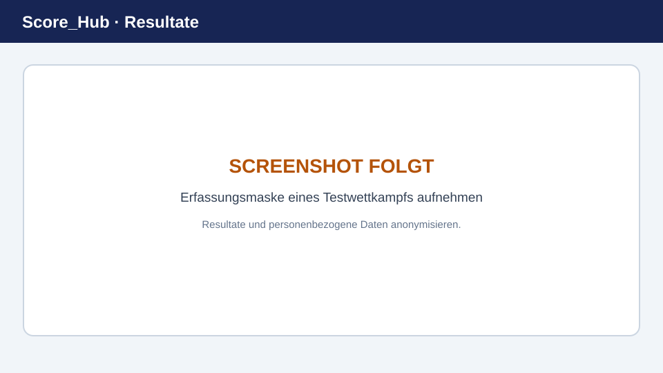

# Resultate – Schnellstart

Diese Anleitung führt durch eine einzelne Resultaterfassung. Sie benötigen Zugriff auf den Wettkampf und die passende Resultaterfassungsrolle.

> **Platzhalterbild:** Ersetzen Sie diese Grafik durch einen aktuellen Screenshot. Details: [Screenshots ersetzen](../screenshots.md).

## In fünf Schritten

1. Öffnen Sie den gewünschten Wettkampf im Dashboard oder in der Navigation.
2. Wechseln Sie zu **Resultate** und suchen Sie den Schützen.
3. Wählen Sie die passende Runde und Kategorie.
4. Erfassen Sie Resultat und alle als erforderlich markierten Felder, zum Beispiel Standort, Datum, Ausrüstung oder Auszeichnung.
5. Speichern Sie den Eintrag und prüfen Sie, ob er in der Resultatübersicht erscheint.

Die genauen Pflichtfelder hängen von der Konfiguration des Wettkampfs ab. Bei einem Fehler kontrollieren Sie zunächst die markierten Pflichtangaben und die für die Runde konfigurierten Grenzwerte.

## Vor dem Erfassen

- Vergewissern Sie sich, dass Sie den richtigen Wettkampf und Schützen geöffnet haben.
- Halten Sie das offizielle Resultat bereit und übertragen Sie es sorgfältig.
- Wenn Sie nur Resultate Ihres Vereins erfassen dürfen, wählen Sie den zugehörigen Verein.

Weiter: [Resultate und Felder im Detail](entering-results.md) · [Resultat korrigieren](editing-results.md)
